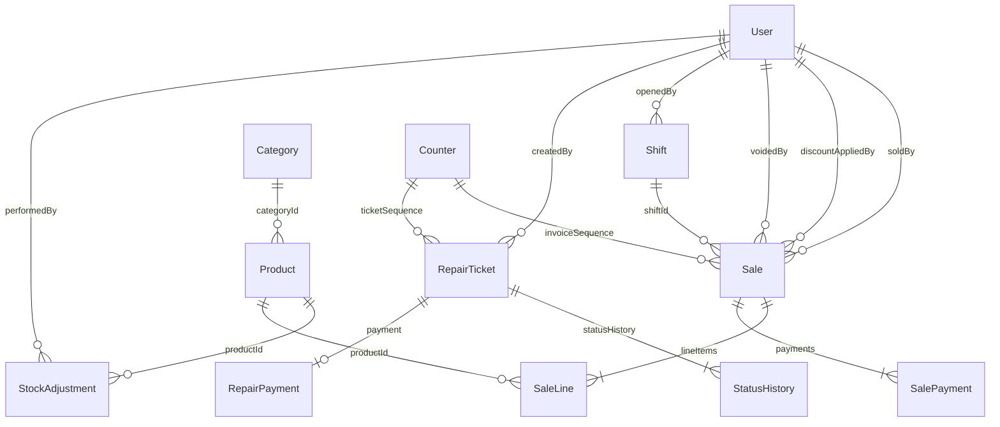

# WATCH REPAIR & SALES POS — COMPLETE IMPLEMENTATION AUDIT AND TECHNICAL HANDOVER

**Audit date:** 28 October 2026  
**Repository:** `watch-shop-pos` (Next.js monolith)  
**Source of requirements:** *POS System Proposal — MVP Phase* (Watch Repair & Sales Shop, LKR 65,000 budget) and the in-repo translation in `docs/MVP-PHASE-ONE-IMPLEMENTATION-GUIDE.md`.  
**Method:** Static inspection of the current source tree, plus non-destructive execution of `npm test` and `npx tsc --noEmit`. No browser walkthrough, no live database writes, no printer, and no production deploy were performed.

This report describes **what the code does today**. A screen or schema field is not treated as a finished business feature unless a route, a guard, and a caller exist.

---

## SECTION A — EXECUTIVE IMPLEMENTATION SUMMARY

`watch-shop-pos` is a single Next.js 16 application that serves both the shop UI and the JSON API. It is built for a watch retail counter plus a repair bench: sell watches, straps, and batteries; track repair tickets from intake to collection; adjust stock; reconcile a cash drawer by shift; and show an admin daily split of retail versus repair income.

The MVP proposal’s **core workflows exist in code**:

- Authenticated checkout with search, categories, cart, line and cart discounts, cash/card/bank transfer, change, stock deduction inside a MongoDB transaction, and an invoice number.
- Browser print receipt (58mm or 80mm width from settings) and a PDF download.
- Admin void of a completed sale, which restores tracked stock.
- Repair tickets with a generated ID, a four-step status machine, a printable claim token, and a payment recorded when the ticket is marked delivered.
- Seeded category tree, product catalog, admin stock adjustments, and an admin low-stock list on the dashboard.
- Shift open/close with expected cash and variance.
- Admin and cashier roles, enforced in middleware for pages and again inside API handlers.

It is **not** the architecture named in the proposal. The proposal asked for an offline-first Windows desktop or XAMPP/Node app on SQLite or local MySQL, with a USB thermal printer driver. The built system is a **networked web app** that requires a running **MongoDB** (the example URI is MongoDB Atlas) and uses the **browser print dialog** plus **Cloudinary** for the shop logo. There is no local sync engine, no service worker, and no Windows installer.

Operational caveats that matter before a shop goes live:

- The daily report buckets sales by **UTC midnight**, not Asia/Colombo. A sale late in the Sri Lankan evening can fall on the wrong business day.
- Expected drawer cash counts **retail cash sales and cash voids only**. Cash collected on a delivered repair is **not** added.
- The repairs board requests `board=true`, which excludes `delivered` tickets, while the UI still renders a Delivered column. That column stays empty.
- MongoDB multi-document transactions (sale and stock adjustment) require a replica set. A standalone local `mongod` will throw when a sale is posted.
- Demo accounts and passwords are created by `scripts/seed.ts` and documented in `README.md`. They must be changed before any shared deployment.
- End-to-end behavior was **not** executed in a browser during this audit. Unit tests cover pagination parsing and one discount scenario only.

**Readiness:** suitable as a supervised pilot on a LAN browser if MongoDB is a replica set and staff accept browser printing. Not ready as an unattended production shop system until the cash-drawer formula, report timezone, reprint history, printer trial, and credential rotation are done.

---

## SECTION B — COMPLETE FEATURE CATALOG

Counted as **49 code-verified features** (a feature is a user or operator capability with a concrete handler or screen, not a proposal bullet).

### Identity and shell

| # | Feature | Where |
|---|---------|--------|
| 1 | Email/password login | `app/login/page.tsx`, `components/auth/login-form.tsx`, `lib/auth/auth.ts` |
| 2 | Logout | `components/pos/pos-shell.tsx` calls `signOut` |
| 3 | JWT session (Auth.js v5) | `lib/auth/auth.config.ts` |
| 4 | Role-filtered navigation | `components/pos/pos-shell.tsx` `nav` |
| 5 | Page guard redirect to login | `middleware.ts` |
| 6 | Inactive users cannot sign in | `User.findOne({ isActive: true })` in `lib/auth/auth.ts` |

### Dashboard

| # | Feature | Where |
|---|---------|--------|
| 7 | Today and 7-day retail sales chart | `app/(pos)/dashboard/page.tsx` queries `Sale` |
| 8 | Open repair preview (latest 4, not delivered) | same page |
| 9 | Shortcut tiles | same page, rendered by `components/pos/dashboard-home.tsx` |
| 10 | Admin low-stock alerts | same page, `$lte` quantity vs `lowStockThreshold` |

### Checkout and money

| # | Feature | Where |
|---|---------|--------|
| 11 | Product search by name or SKU | `GET /api/products` via `lib/products/product-list-query.ts` |
| 12 | Category quick filters | `components/pos/checkout-client.tsx` |
| 13 | Product grid pagination (12 per page) | same |
| 14 | Add / increment / decrement / remove cart lines | same |
| 15 | Per-line flat or percent discount | same, math in `lib/money/calculate-sale.ts` |
| 16 | Cart flat or percent discount | same |
| 17 | Cash, card, bank transfer (one method per sale) | checkout UI; `payments[]` on `Sale` |
| 18 | Cash tendered and change | checkout UI; stored on the payment subdocument |
| 19 | Sale blocked unless a shift is open | `POST /api/sales` |
| 20 | Payment total must equal sale total | same |
| 21 | Insufficient stock blocks the sale | same, inside a MongoDB transaction |
| 22 | Tracked stock decremented on success | same |
| 23 | Invoice number `INV-YYYYMMDD-####` | `lib/ids/generate.ts` |
| 24 | Discount actor stored when any discount is non-zero | `Sale.discountAppliedBy` |
| 25 | Receipt screen after sale | redirect to `/sales/[id]` |

### Receipts

| # | Feature | Where |
|---|---------|--------|
| 26 | Browser print of receipt | `components/pos/receipt-view.tsx` `window.print()` |
| 27 | Paper width 58mm or 80mm | `ShopSettings.receiptPaperWidth`, applied as CSS max width |
| 28 | Logo, address, phone, lines, discounts, change, thank-you note | receipt view and `lib/receipts/sale-pdf.tsx` |
| 29 | PDF download | `GET /api/sales/[id]/pdf` |
| 30 | Admin void with reason and stock restore | `POST /api/sales/[id]/void` and receipt UI |

### Repairs

| # | Feature | Where |
|---|---------|--------|
| 31 | Create ticket (name, phone, brand, model, issue, estimate) | `components/pos/repair-form.tsx`, `POST /api/repairs` |
| 32 | Ticket ID `R-YYYYMMDD-####` | `lib/ids/generate.ts` |
| 33 | Kanban of non-delivered tickets | `components/pos/repairs-board.tsx` |
| 34 | Forward status changes with server rules | `lib/repairs/transitions.ts`, `PATCH /api/repairs/[id]` |
| 35 | Status history rows | `RepairTicket.statusHistory` |
| 36 | Payment captured when moving to delivered | repair detail sends `payment` |
| 37 | Printable claim token with terms | `components/pos/claim-token-view.tsx` |

### Inventory

| # | Feature | Where |
|---|---------|--------|
| 38 | Product table with search, category, stock, brand, price, sort, pagination | `components/pos/products-admin.tsx`, `components/pos/inventory-filters.tsx` |
| 39 | Header totals from the filtered set, not the current page | `summary` on `GET /api/products` |
| 40 | Create product | `components/pos/product-new-client.tsx` |
| 41 | View and edit product | `components/pos/product-detail-client.tsx` |
| 42 | Brand and battery size | `Product.attributes` |
| 43 | Soft-remove from catalog (`isActive: false`) | `DELETE /api/products/[id]` |
| 44 | Stock adjustment (purchase, damage, correction, other) | `components/pos/stock-adjustments-form.tsx` |
| 45 | Adjustment history pagination | `GET /api/stock-adjustments` |

### Reporting, shifts, staff, settings

| # | Feature | Where |
|---|---------|--------|
| 46 | Daily retail vs repair report and payment mix | `components/pos/daily-report.tsx`, `GET /api/reports/daily` |
| 47 | Open shift with opening float | `POST /api/shifts`, `components/pos/shift-bar.tsx` |
| 48 | Close shift, expected cash, variance toast | `POST /api/shifts/[id]/close` |
| 49 | Staff create, edit, role change, deactivate, password reset | `components/pos/users-admin.tsx` |
| — | Shop settings and logo upload are part of feature 49’s settings surface, counted inside settings below as the same module | `components/pos/settings-form.tsx`, `POST /api/uploads/image` |

Settings (shop name, contacts, thank-you note, repair terms, paper width, logo) are implemented and are included in the feature catalog as part of the settings module rather than a 50th isolated bullet, to avoid double-counting. The low-stock API `GET /api/reports/low-stock` exists in addition to the dashboard query.

**Partially wired or unused in the UI (not counted as complete features):**

- `ShopSettings.taxEnabled` is stored and patchable, never read by `calculateSaleTotals`.
- `Product.costCents`, `imageUrl`, and `imageCloudinaryId` exist on the schema. The product form does not edit them. Logo upload is the only Cloudinary caller.
- `Category.parentId` and `POST /api/categories` exist. There is no category admin screen.
- `zod` is a dependency and is not imported by application code. Validation is hand-written in route handlers.
- The shell bell icon has no click handler and no notification store.
- Repair intake photo URL is a schema field. The repair form does not upload a photo.

---

## SECTION C — PROPOSAL COMPLIANCE REPORT

Statuses mean:

- **IMPLEMENTED BUT NOT TESTED** — the code path exists; this audit did not execute it in a browser or against a database.
- **PARTIALLY IMPLEMENTED** — a required behavior is missing or only half connected.
- **IMPLEMENTED BUT BROKEN** — the code runs a rule that does not match the business day or the screen it claims to show.
- **DIFFERENT FROM PROPOSAL** — a working substitute that is not the specified design.
- **NOT IMPLEMENTED** — no working path.
- **CANNOT VERIFY** — needs a printer, LAN device, or live shop session.

| ID | Proposal requirement | Current implementation | Status | Evidence | Missing | Testing |
|----|----------------------|------------------------|--------|----------|---------|---------|
| SAL-01 | Fast, touch-friendly checkout | Two-column checkout: product grid and cart. Buttons use roughly 44px targets (`min-h-11` / `size-9`). No measured click-count test. | IMPLEMENTED BUT NOT TESTED | `components/pos/checkout-client.tsx` | Tap-count acceptance not measured | Not executed |
| SAL-02 | Search by name | `q` regex on `name` and `sku`, debounced in checkout | IMPLEMENTED BUT NOT TESTED | `lib/products/product-list-query.ts` | — | Not executed |
| SAL-03 | Search by SKU | Same `q` field matches `sku` | IMPLEMENTED BUT NOT TESTED | same | No barcode scanner integration | Not executed |
| SAL-04 | Category quick buttons | Pill filters call `categoryId` | IMPLEMENTED BUT NOT TESTED | `checkout-client.tsx` | — | Not executed |
| SAL-05 | 58/80mm thermal receipt with logo, contact, lines, discounts, thank-you | CSS `@media print` sizes the receipt to the settings width. Content is in the receipt article. Printing is the browser dialog, not a USB driver. | PARTIALLY IMPLEMENTED | `components/pos/receipt-view.tsx`, `models/ShopSettings.ts` | No OS printer API, no failure handling if no printer | CANNOT VERIFY on hardware |
| SAL-06 | Digital PDF receipt, local export / share | PDF download attachment. No email, WhatsApp, or share sheet. | PARTIALLY IMPLEMENTED | `app/api/sales/[id]/pdf/route.tsx`, `lib/receipts/sale-pdf.tsx` | Share channel | Not executed |
| SAL-07 | Line flat discount | Cart line select “Flat LKR”; value stored in cents | IMPLEMENTED BUT NOT TESTED | `checkout-client.tsx`, `lib/money/calculate-sale.ts` | — | Math unit-tested only as part of a combined case |
| SAL-08 | Line percent discount | Same control, percent type | IMPLEMENTED BUT NOT TESTED | same | — | Not isolated |
| SAL-09 | Cart flat discount | Cart discount select | IMPLEMENTED BUT NOT TESTED | `checkout-client.tsx` | — | Not executed |
| SAL-10 | Cart percent discount | Same | IMPLEMENTED BUT NOT TESTED | `calculate-sale.ts` | — | One unit test combines line flat + cart 10% |
| SAL-11 | Admin and cashier may discount; audit who applied | Both roles pass `requireRole` on `POST /api/sales`. `discountAppliedBy` set when `discountTotalCents > 0`. No second approver. | IMPLEMENTED BUT NOT TESTED | `app/api/sales/route.ts`, `models/Sale.ts` | — | Not executed |
| SAL-12 | Cash tendered and change | Cash shows tendered input and change. Server rejects tender below amount. | IMPLEMENTED BUT NOT TESTED | `checkout-client.tsx`, `app/api/sales/route.ts` | — | Not executed |
| SAL-13 | Card payment | Single select value `card`. No change field. | IMPLEMENTED BUT NOT TESTED | same | No card terminal integration (not required) | Not executed |
| SAL-14 | Bank transfer | Value `bank_transfer` | IMPLEMENTED BUT NOT TESTED | same | — | Not executed |
| SAL-15 | Stock drops atomically; insufficient stock blocks sale | `mongoose.startSession()` transaction in `POST /api/sales` | IMPLEMENTED BUT NOT TESTED | `app/api/sales/route.ts` | Fails on standalone MongoDB without a replica set | Not executed |
| SAL-16 | Cashier cannot delete invoices; admin void restores stock | No DELETE sale route. Void is `requireRole(["admin"])` and adds quantity back when `trackInventory` is true. | IMPLEMENTED BUT NOT TESTED | `app/api/sales/[id]/void/route.ts`, `receipt-view.tsx` | No partial refund | Not executed |
| REP-01 | Ticket fields | Form and POST require name, phone, brand, model, issue, estimate | IMPLEMENTED BUT NOT TESTED | `components/pos/repair-form.tsx`, `app/api/repairs/route.ts` | Intake photo not collected in the form | Not executed |
| REP-02 | Unique ticket ID | `R-` + date + sequence via `Counter` | IMPLEMENTED BUT NOT TESTED | `lib/ids/generate.ts`, unique index on `ticketId` | — | Not executed |
| REP-03 | Pending → In progress → Ready → Delivered | Forward map in `canTransition`. Delivered requires a payment payload. Delivered is terminal. Admin may step backward one state in the API only. | IMPLEMENTED BUT NOT TESTED | `lib/repairs/transitions.ts`, `app/api/repairs/[id]/route.ts` | UI only offers the next forward status. No cancel. No notifications. | Not executed |
| REP-04 | Visual board of watches in the shop | Four columns rendered. Fetch is `/api/repairs?board=true`, which drops `delivered`. | IMPLEMENTED BUT BROKEN | `components/pos/repairs-board.tsx` line 70; `app/api/repairs/route.ts` | Delivered column never fills. No search or status filter control. | Not executed; defect is visible in source |
| REP-05 | Claim token with ID, estimate, terms | Print view | IMPLEMENTED BUT NOT TESTED | `components/pos/claim-token-view.tsx`, `app/(pos)/repairs/[id]/token/page.tsx` | Hardware print | CANNOT VERIFY |
| REP-06 | Repair income in the daily split | Delivered tickets with `payment.paidAt` inside the UTC day are summed | PARTIALLY IMPLEMENTED | `app/api/reports/daily/route.ts` | UTC day boundary. Repair cash omitted from drawer expected cash (`lib/shifts/cash.ts`) | Not executed |
| REP-07 | Cashier creates and updates tickets; cannot delete | POST and PATCH allow cashier. No DELETE handler. Field edits on PATCH without `status` are admin-only and the UI does not expose them. | PARTIALLY IMPLEMENTED | `app/api/repairs/route.ts`, `app/api/repairs/[id]/route.ts` | Cashier cannot correct a typed customer name. No ticket search. | Not executed |
| INV-01 | Six predefined categories | Seeded: Men’s, Women’s, Smartwatches, Leather Straps, Metal Bracelets, Batteries | IMPLEMENTED BUT NOT TESTED | `scripts/seed.ts` `categories` | No UI to add categories. `POST /api/categories` is unused by the UI. | Not executed |
| INV-02 | Battery size/model | `attributes.batterySize` and brand on the product form | IMPLEMENTED BUT NOT TESTED | `components/pos/product-form.tsx`, `models/Product.ts` | Not restricted to the Batteries category | Not executed |
| INV-03 | Real-time deduction on checkout | Same transaction as SAL-15 | IMPLEMENTED BUT NOT TESTED | `app/api/sales/route.ts` | Products with `trackInventory: false` are not decremented | Not executed |
| INV-04 | Admin stock increase with reason | Reason `purchase` (and other positive deltas) | IMPLEMENTED BUT NOT TESTED | `app/api/stock-adjustments/route.ts` | — | Not executed |
| INV-05 | Write-off cannot go negative | `newQty < 0` returns 400 | IMPLEMENTED BUT NOT TESTED | same | — | Not executed |
| INV-06 | Cashier cannot change quantities directly | Adjustments and product PATCH/POST/DELETE are admin-only. Nav hides Stock. | IMPLEMENTED BUT NOT TESTED | `lib/rbac/permissions.ts`, product and adjustment routes | Admin product edit can still set `quantity` without an adjustment row | Not executed |
| INV-07 | Admin dashboard low-stock alert | Up to 8 products, message “Alert: {name} below {threshold} units” | IMPLEMENTED BUT NOT TESTED | `app/(pos)/dashboard/page.tsx`, `components/pos/dashboard-home.tsx` | Cashiers do not see this block (`isAdmin` gate) | Not executed |
| RPT-01 | Daily sales total for a calendar day | Sum of completed sale `totalCents` plus repair payments | IMPLEMENTED BUT BROKEN | `dayRange` in `app/api/reports/daily/route.ts` uses `Z` (UTC) | Shop-local calendar day | Not executed |
| RPT-02 | Retail vs repair split | `retailCents` and `repairCents` shown on the report page | PARTIALLY IMPLEMENTED | `components/pos/daily-report.tsx` | Same UTC window | Not executed |
| RPT-03 | Drawer reconciliation: float + cash sales − cash voids vs counted cash | Shift close computes that formula and stores `varianceCents` | PARTIALLY IMPLEMENTED | `lib/shifts/cash.ts`, `app/api/shifts/[id]/close/route.ts` | Repair cash in/out is ignored. No historical shift report screen. | Not executed |
| RPT-04 | Cashier sees current shift cash | Shift bar and right rail call `GET /api/shifts` | PARTIALLY IMPLEMENTED | `components/pos/shift-bar.tsx`, `components/pos/pos-shell.tsx` | Figure excludes repair cash, so it is not the physical drawer if repairs are paid in cash | Not executed |
| SEC-01 | Admin: inventory, reports, staff, settings, sales, repairs | Admin passes `canAccessPath` and admin route guards | IMPLEMENTED BUT NOT TESTED | `lib/rbac/permissions.ts` | “Delete inventory” is a soft archive, not a hard delete | Not executed |
| SEC-02 | Cashier: sales, repairs, shift cash; no invoice delete; no stock edit | Page block list plus API roles | IMPLEMENTED BUT NOT TESTED | `middleware.ts`, API `requireRole` | — | Not executed |
| SEC-03 | Login required; session cookie | Middleware redirects anonymous users. Auth.js JWT. | IMPLEMENTED BUT NOT TESTED | `middleware.ts`, `lib/auth/auth.config.ts` | `GET /api/health` is public | Not executed |
| SEC-04 | Mutating APIs check role | Every business route inspected calls `requireSession` or `requireRole` | IMPLEMENTED BUT NOT TESTED | grep of `requireRole` / `requireSession` under `app/api` | Health is unauthenticated | Not executed |
| SEC-05 | Create, disable, role, reset password | Staff screen and `PATCH /api/users/[id]` | IMPLEMENTED BUT NOT TESTED | `components/pos/users-admin.tsx`, `app/api/users/[id]/route.ts` | — | Not executed |
| ARCH-1 | Offline-first on the shop PC | Every list and sale calls HTTP APIs that call MongoDB. No IndexedDB, no service worker. | NOT IMPLEMENTED | `lib/db/mongoose.ts` | Entire offline design | CANNOT VERIFY as absent by design |
| ARCH-2 | SQLite or local MySQL | MongoDB via Mongoose | DIFFERENT FROM PROPOSAL | `package.json`, `lib/db/mongoose.ts` | — | n/a |
| ARCH-3 | USB thermal printer driver | Browser `window.print()` | DIFFERENT FROM PROPOSAL | `receipt-view.tsx`, `claim-token-view.tsx` | Driver, printer picker, connection errors | CANNOT VERIFY |
| ARCH-4 | Windows install and handover | README dev/LAN commands and `scripts/backup-mongo.sh` only. No installer, no Windows service unit. | NOT IMPLEMENTED | `README.md`, `scripts/backup-mongo.sh` | Installer, training record, printer sign-off | Not executed |

**Score used for “proposal implementation coverage”** (39 functional IDs SAL-01–SEC-05, architecture excluded):

- Full credit (1): code meets the requirement even if untested in this audit. Count: SAL-01–04, SAL-07–16 (14), REP-01–03, REP-05, REP-07 (5), INV-01–07 (7), SEC-01–05 (5) = **31**.
- Half credit (0.5): SAL-05, SAL-06, REP-04, REP-06, RPT-01, RPT-02, RPT-03, RPT-04 = **8 × 0.5 = 4**.
- Zero: none of the 39 functional IDs are entirely absent.
- **31 + 4 = 35 / 39 ≈ 90% implementation coverage.**
- This is **not** a test pass rate. Verification coverage of those 39 IDs in this audit is **0 executed end-to-end flows**.

Architecture items ARCH-1 and ARCH-4 are not implemented. ARCH-2 and ARCH-3 are deliberate substitutions.

---

## SECTION D — FRONTEND ARCHITECTURE

### Stack

- React 19.3, Next.js 16.4.3 App Router, TypeScript 5.
- Tailwind CSS 4, shadcn-style primitives on Base UI (`components/ui/*`), Lucide icons, Framer Motion on several POS screens, Sonner toasts.
- Client components (`"use client"`) own forms and lists. A few pages are server components that load MongoDB directly (dashboard, receipt page, repair detail, product detail, claim token).
- `next.config.ts` sets `cacheComponents`, `partialPrefetching`, and `serverExternalPackages: ["@react-pdf/renderer"]`.

### Navigation

`components/pos/pos-shell.tsx` renders the sidebar. Cashiers do not see Stock, Reports, Settings, or Staff. Middleware redirects them if they type those URLs (`lib/rbac/permissions.ts` `adminOnlyPaths`). Home `/` redirects to `/dashboard` (`app/page.tsx`).

The right rail search submits to `/checkout?q=...`. **Checkout does not read `useSearchParams`**, so that search does nothing to the product query. The bell is decorative.

### Screen inventory

| Screen | Route | Purpose | Main behavior | APIs | Status | Source |
|--------|-------|---------|---------------|------|--------|--------|
| Login | `/login` | Sign in | Email and password | Auth.js credentials | Implemented, not exercised here | `app/login/page.tsx`, `components/auth/login-form.tsx` |
| Dashboard | `/dashboard` | Home | Chart, repairs, shortcuts, admin low stock | Direct MongoDB in the server page, not `/api/reports/*` | Implemented | `app/(pos)/dashboard/page.tsx`, `components/pos/dashboard-home.tsx` |
| Checkout | `/checkout` | POS | Search, categories, cart, pay | `GET /api/products`, `GET /api/categories`, `POST /api/sales` | Implemented | `components/pos/checkout-client.tsx` |
| Repairs board | `/repairs` | Kanban | Open tickets by status | `GET /api/repairs?board=true` | Delivered column broken | `components/pos/repairs-board.tsx` |
| New repair | `/repairs/new` | Intake | Required fields, redirect to token | `POST /api/repairs` | Implemented | `components/pos/repair-form.tsx` |
| Repair detail | `/repairs/[id]` | Advance status | Next status, payment method when delivering, link to token | `PATCH /api/repairs/[id]` | No field edit, no admin rollback button | `components/pos/repair-detail.tsx` |
| Claim token | `/repairs/[id]/token` | Print token | `window.print()` | Server load of ticket and settings | Implemented | `components/pos/claim-token-view.tsx` |
| Inventory | `/inventory/products` | Catalog | Filters, table, pagination | `GET /api/products`, `/api/categories`, `/api/products/facets` | Implemented | `components/pos/products-admin.tsx` |
| New product | `/inventory/products/new` | Admin create | Form | `POST /api/products` | Implemented; non-admin sees a refusal message | `components/pos/product-new-client.tsx` |
| Product detail | `/inventory/products/[id]` | View/edit/archive | `?edit=1` opens the form | `PATCH` and `DELETE /api/products/[id]` | Implemented | `components/pos/product-detail-client.tsx` |
| Stock adjustments | `/inventory/adjustments` | Admin qty changes | Form plus paged history | `GET/POST /api/stock-adjustments`, products `picker=true&limit=200` | Implemented | `components/pos/stock-adjustments-form.tsx` |
| Daily report | `/reports/daily` | EOD | Date picker, retail/repair/payments | `GET /api/reports/daily` | Implemented; UTC bug | `components/pos/daily-report.tsx` |
| Receipt | `/sales/[id]` | Print, PDF, void | — | Sale loaded in the server page; PDF and void are separate APIs | Implemented | `components/pos/receipt-view.tsx` |
| Settings | `/settings` | Shop profile | Text fields, paper width, logo file | `GET/PATCH /api/settings`, `POST /api/uploads/image` | Implemented; tax toggle not in the form | `components/pos/settings-form.tsx` |
| Staff | `/users` | Team | List, create, edit dialog | `GET/POST /api/users`, `PATCH /api/users/[id]` | Implemented | `components/pos/users-admin.tsx` |

There is **no** sales history page, category manager, customer directory, supplier screen, or shift history page.

Shared UI that is not a route: `DataPagination` (`components/ui/data-pagination.tsx`), `InventoryFilters`, `ShiftBar`, `PosShell`.

---

## SECTION E — BACKEND ARCHITECTURE

There is no separate service layer. Each `app/api/**/route.ts` handler authenticates, connects Mongoose, validates a few fields, and writes documents. Money rules live in `lib/money/calculate-sale.ts`. Repair rules live in `lib/repairs/transitions.ts`. Product filters live in `lib/products/product-list-query.ts`.

### Response shape

- Success: `{ data }` from `jsonOk` (`lib/api/response.ts`).
- Paginated lists: `{ data, pagination, summary? }` from `jsonPaginated`.
- Errors: `{ error: { code, message, details? } }` with 4xx/5xx.

`pagination` is `{ page, limit, total, totalPages, hasNextPage, hasPrevPage }` (`lib/api/pagination.ts`). Default limit 20, max 100, except sales max 50 and products max 200 when `picker=true`.

### API inventory

Auth column is the **handler** check. Middleware also rejects anonymous `/api/*` except `/api/auth` and `/api/health`.

| Method | Endpoint | Purpose | Auth | Roles | Request (main fields) | Response | Status | Handler |
|--------|----------|---------|------|-------|------------------------|----------|--------|---------|
| GET | `/api/health` | DB ping | Public | — | — | `{ status, db }` or 503 | Implemented, unused by UI | `app/api/health/route.ts` |
| * | `/api/auth/[...nextauth]` | Login/session/CSRF | Public entry | — | Auth.js | Auth.js | Implemented | `app/api/auth/[...nextauth]/route.ts` |
| GET | `/api/categories` | Active categories | Session | any | — | category array | Used by checkout, inventory, product forms | `app/api/categories/route.ts` |
| POST | `/api/categories` | Create category | Role | admin | `name`, `slug` | category | **No UI caller** | same |
| GET | `/api/products` | Filtered, paged catalog | Session | any; `includeInactive` admin-only | `q`, `category`, `categoryId`, `stock`, `brand`, `priceMin`, `priceMax`, `trackInventory`, `sort`, `page`, `limit`, `picker` | items, pagination, summary | Used | `app/api/products/route.ts` |
| POST | `/api/products` | Create product | Role | admin | name, sku, categoryId, priceCents, … | product 201 | Used | same |
| GET | `/api/products/facets` | Distinct brands | Session | any | — | `{ brands }` | Used by inventory filters | `app/api/products/facets/route.ts` |
| GET | `/api/products/[id]` | One product | Session | any | — | product | Not used by the detail page (server component loads Mongo directly) | `app/api/products/[id]/route.ts` |
| PATCH | `/api/products/[id]` | Update product | Role | admin | whitelisted fields plus `attributes` | product | Used | same |
| DELETE | `/api/products/[id]` | Soft archive | Role | admin | — | product with `isActive: false` | Used | same |
| GET | `/api/repairs` | List or board | Role | admin, cashier | `board=true` skips pagination and drops delivered | tickets or paginated list | Board uses `board=true`. Paginated list has **no UI** | `app/api/repairs/route.ts` |
| POST | `/api/repairs` | Create ticket | Role | admin, cashier | customer and watch fields, `estimatedCostCents` | ticket 201 | Used | same |
| GET | `/api/repairs/[id]` | One ticket | Role | admin, cashier | — | ticket | Detail page loads Mongo directly; this route is unused by that page | `app/api/repairs/[id]/route.ts` |
| PATCH | `/api/repairs/[id]` | Status and/or admin field edit | Role | admin, cashier | `status`, optional `payment`, `note`; or admin field patch | ticket | Status path used. Field patch **no UI** | same |
| GET | `/api/sales` | Paged sales | Role | admin, cashier | `page`, `limit` | sales | **No UI caller** (checkout only POSTs) | `app/api/sales/route.ts` |
| POST | `/api/sales` | Complete sale | Role | admin, cashier | `lineItems`, `cartDiscount`, `payments` | sale 201 | Used | same |
| GET | `/api/sales/[id]` | One sale | Role | admin, cashier | — | sale | Receipt page loads Mongo directly | `app/api/sales/[id]/route.ts` |
| POST | `/api/sales/[id]/void` | Void and restock | Role | admin | `{ voidReason }` | sale | Used by receipt | `app/api/sales/[id]/void/route.ts` |
| GET | `/api/sales/[id]/pdf` | PDF file | Role | admin, cashier | — | `application/pdf` | Linked from receipt | `app/api/sales/[id]/pdf/route.tsx` |
| GET | `/api/stock-adjustments` | Paged history | Role | admin | `page`, `limit` | rows | Used | `app/api/stock-adjustments/route.ts` |
| POST | `/api/stock-adjustments` | Apply delta | Role | admin | `productId`, `delta`, `reason`, `note` | adjustment 201 | Used | same |
| GET | `/api/users` | Paged staff | Role | admin | `page`, `limit` | users without password, summary counts | Used | `app/api/users/route.ts` |
| POST | `/api/users` | Create user | Role | admin | email, name, password ≥ 8, role | user 201 | Used | same |
| PATCH | `/api/users/[id]` | Edit user | Role | admin | name, role, isActive, password | user | Used | `app/api/users/[id]/route.ts` |
| GET | `/api/shifts` | Open shift and expected cash | Role | admin, cashier | — | `{ open, expectedCashCents }` | Used | `app/api/shifts/route.ts` |
| POST | `/api/shifts` | Open shift | Role | admin, cashier | `openingFloatCents` | shift 201; 409 if one is open | Used | same |
| POST | `/api/shifts/[id]/close` | Close and reconcile | Role | admin, cashier | `countedCashCents`, optional `notes` | shift with variance | Used | `app/api/shifts/[id]/close/route.ts` |
| GET | `/api/settings` | Shop settings | Session | any signed-in user | — | settings or `{}` | Used by settings form. Cashiers can read if they call the API; the page is admin-only. | `app/api/settings/route.ts` |
| PATCH | `/api/settings` | Update settings | Role | admin | whitelisted keys including `taxEnabled` | settings | Used, except the UI never sends `taxEnabled` | same |
| GET | `/api/reports/daily` | EOD totals | Role | admin | `date=YYYY-MM-DD` | retail, repair, payments, counts | Used | `app/api/reports/daily/route.ts` |
| GET | `/api/reports/low-stock` | Low-stock products | Role | admin | — | products | **No UI caller**; dashboard queries Mongo itself | `app/api/reports/low-stock/route.ts` |
| POST | `/api/uploads/image` | Logo upload | Role | admin | multipart `file` | `{ url, publicId }` | Used by settings | `app/api/uploads/image/route.ts` |

**Endpoint count:** 31 application handlers in the table after the Auth.js catch-all, plus the Auth.js catch-all. **32 route modules.**

### Sale rules (confirmed in `POST /api/sales`)

1. At least one line.
2. An open `Shift` must exist (`SHIFT_REQUIRED`).
3. Totals come from `calculateSaleTotals`, not from a client-supplied total.
4. Sum of `payments[].amountCents` must equal `totalCents`.
5. Cash payments must include `tenderedCents` ≥ amount; `changeCents` is computed on the server.
6. Each product is loaded in the transaction. Missing product aborts. If `trackInventory` and `quantity < line.quantity`, abort with `STOCK_INSUFFICIENT`.
7. Quantity is reduced and the sale is inserted in the same transaction.
8. Line snapshots store name and SKU so later catalog edits do not rewrite history.

### Discount math (`lib/money/calculate-sale.ts`)

- Line base = unit price cents × quantity.
- Flat discount subtracts `value` cents, floored at 0.
- Percent discount uses `round(base * (100 - percent) / 100)` with percent clamped to 0–100.
- Cart discount applies to the sum of line totals, after line discounts.
- `subtotalCents` in the return value is the sum **after** line discounts, not the pre-discount gross. The receipt labels this “Subtotal”. A reader who expects pre-discount subtotal will disagree with the label. The unit test expects `subtotalCents === 24000` for lines of 20000 and 5000 after a 1000 cent line discount, which matches this definition.

### Repair rules

`canTransition` allows only the next forward status. Delivered requires `payment.method` and `payment.amountCents`. Admin may move `in_progress → pending` and `ready → in_progress`. The detail UI never offers those backward moves. There is no cancelled status.

---

## SECTION F — DATABASE ARCHITECTURE

Engine: **MongoDB**. ODM: **Mongoose 9**. There are **no migration files**. Shape changes apply when the process loads the schema; existing documents are not backfilled automatically.

Collections (**9**):

| Collection | Model file | Identity | Notes |
|------------|------------|----------|--------|
| `users` | `models/User.ts` | ObjectId, unique email | `passwordHash` bcrypt cost 12. Role enum `admin` \| `cashier`. `isActive` default true. |
| `categories` | `models/Category.ts` | ObjectId, unique slug | Optional `parentId`. No tree UI. |
| `products` | `models/Product.ts` | ObjectId, unique SKU | `priceCents`, optional `costCents`, `quantity` min 0, `lowStockThreshold` default 10, `attributes.brand`, `attributes.batterySize`, `isActive`, `trackInventory`. Text index on name and sku (queries use regex, not `$text`). |
| `sales` | `models/Sale.ts` | ObjectId, unique `invoiceNumber` | Embedded `lineItems` and `payments`. Status `completed` \| `voided`. `shiftId`, `soldBy`, optional `discountAppliedBy`. Index `{ createdAt: -1 }`. No `updatedAt`. |
| `repairtickets` | `models/RepairTicket.ts` | ObjectId, unique `ticketId` | Embedded `statusHistory` and optional `payment`. Index `{ status: 1, updatedAt: -1 }`. |
| `stockadjustments` | `models/StockAdjustment.ts` | ObjectId | `delta`, reason enum, `performedBy`. |
| `shifts` | `models/Shift.ts` | ObjectId | One open shift enforced in the POST handler, not by a partial unique index. |
| `shopsettings` | `models/ShopSettings.ts` | String `_id` default `"shop"` | Single document. |
| `counters` | `models/Counter.ts` | String `_id` such as `invoice-20261028` | `seq` incremented with `findByIdAndUpdate` upsert. |

There are **no Mongoose `ref` populate constraints enforced by the database**. A deleted user id can remain on a sale. Soft-archived products remain referenced by historical lines, which is intentional because lines copy name and SKU.

### ER diagram (actual)



`SaleLine`, `SalePayment`, `StatusHistory`, and `RepairPayment` are embedded subdocuments, not separate collections.

### Money

All money fields are **integers of cents**. Display uses `formatLkr` (`lib/money/format.ts`) with `en-LK` / `LKR`. There is no tax line. `taxEnabled` is unused by calculation.

### Integrity risks

- Sale and adjustment use transactions. Void uses a transaction. Repair status update does not need multi-document stock changes.
- Two cashiers can sell the last unit only if both pass the in-transaction check. That is safe **when transactions work**.
- Direct `PATCH` of `Product.quantity` from the product form does not write a `StockAdjustment`. The ledger and the balance can diverge.
- Open-shift uniqueness is application-level only.
- `nextSequence` is not run inside the sale transaction, so a failed sale can still consume an invoice number.

---

## SECTION G — AUTHENTICATION AND AUTHORIZATION

| Concern | Implementation |
|---------|----------------|
| Login | Credentials provider, email lowercased, `isActive: true`, bcrypt compare (`lib/auth/auth.ts`) |
| Session | JWT strategy, `user.id` and `user.role` copied in callbacks |
| Cookie | Auth.js default httpOnly session cookie (framework behavior; not reimplemented in app code) |
| Password storage | `passwordHash` only. Create and reset hash with bcrypt cost 12 |
| Logout | `signOut({ callbackUrl: "/login" })` |
| Page ACL | `middleware.ts` plus `canAccessPath` |
| API ACL | `requireSession` / `requireRole` in each handler |

### Role × capability

| Capability | Admin | Cashier | Evidence |
|------------|-------|---------|----------|
| Login / logout | Yes | Yes | Auth + shell |
| Dashboard | Yes | Yes | No role gate on `/dashboard`. Low-stock block is admin-only in the page query |
| Checkout and `POST /api/sales` | Yes | Yes | `requireRole(["admin","cashier"])` |
| Apply discounts | Yes | Yes | No extra role check |
| Void sale | Yes | No | Void route and receipt button |
| View receipt / PDF if they know the id | Yes | Yes | `requireRole` on those GET routes |
| Open and close shift | Yes | Yes | Shift routes |
| See expected shift cash | Yes | Yes | Shift bar |
| Create and advance repairs | Yes | Yes | Repair routes |
| Edit repair customer fields | API yes | API no | PATCH field branch `user.role === "admin"`; UI does not call it |
| Delete repair | No route | No route | — |
| View inventory | Yes | Yes | Page not in `adminOnlyPaths` |
| Create, edit, archive products | Yes | No | Product POST/PATCH/DELETE |
| Stock adjustments | Yes | No | Route and `/inventory/adjustments` |
| Daily report | Yes | No | Page and API |
| Low-stock API | Yes | No | `requireRole(["admin"])` |
| Settings page and PATCH | Yes | No | Page and PATCH. GET settings is any session |
| Staff management | Yes | No | User routes and `/users` |
| Upload images | Yes | No | Upload route |

There is no technician role. The seed’s “technician” user is a **cashier** (`scripts/seed.ts`).

Frontend hiding is not the only control: stock, report, settings, and user mutations return 403 from `requireRole` for a cashier session.

---

## SECTION H — BUSINESS WORKFLOWS

### 1–3. Admin login, create product, receive stock

1. `/login` posts credentials. Auth.js loads `User`, checks bcrypt, issues a JWT. Middleware then allows `/dashboard`.
2. Admin opens `/inventory/products/new`, submits `POST /api/products` with cents price, quantity, threshold, brand, battery size. SKU is uppercased. Duplicate SKU returns 409.
3. “Receive stock” is not a purchase-order module. Admin opens `/inventory/adjustments`, chooses a product, a positive delta, reason `purchase`, optional note. `POST /api/stock-adjustments` adds delta inside a transaction and inserts a ledger row. Negative results are rejected.

**Gap:** editing quantity on the product form writes `quantity` directly and skips the ledger.

### 4–9. Cashier sale through receipt

1. Cashier opens `/checkout`. If no shift is open, the sale API returns 400 `SHIFT_REQUIRED`. The shift bar can open a float via `POST /api/shifts`.
2. Products load from `GET /api/products` (active only, page size 12).
3. Cart is **browser state only** until submit.
4. Cash: UI computes change as tendered minus total. Server recomputes totals and change.
5. `POST /api/sales` decrements stock and inserts the sale.
6. Browser goes to `/sales/[id]`. Print uses `window.print()`. PDF is a GET that renders `@react-pdf/renderer`.

**Stops:** no held tickets, no split tender, no customer record, no automatic print, no sales list to reprint later unless the receipt URL is still known.

### 10–14. Repair intake through collection

1. `/repairs/new` posts the ticket. Status starts `pending` with a history row “Ticket created”.
2. UI routes to `/repairs/[id]/token` for the claim print.
3. Board and detail move Pending → In progress → Ready for Collection → Delivered. The last step sends `payment: { method, amountCents: estimatedCostCents }`.
4. Daily report includes that payment if `payment.paidAt` falls in the UTC day.

**Stops:** no customer SMS, no technician assignment, no editable estimate at collection (UI always sends the original estimate; the API would accept another amount if a client sent it), delivered cards do not appear on the board.

### 15. Daily report

Admin picks a date. `GET /api/reports/daily?date=` sums completed sales and delivered repair payments. Voided sales are excluded (`status: "completed"`). There is no export button.

### 16. Drawer reconciliation

Close shift sends counted cash. Expected = opening float + completed cash payments on that `shiftId` since `openedAt` − voided cash payments. Variance = counted − expected. Stored on the shift. **Repair cash is not in the formula.**

### 17. Low stock

Admin dashboard queries products with `trackInventory`, `isActive`, and `quantity <= lowStockThreshold`, limit 8. Inventory also shows a low-stock chip that sets `stock=low`.

### 18. Staff

Admin creates a user (`POST /api/users`) or edits name, role, active flag, and optional new password (`PATCH /api/users/[id]`). Deactivated users fail `authorize` because of `isActive: true`.

---

## SECTION I — PRINTING, OFFLINE, AND DEPLOYMENT

| Topic | What exists | Tested on hardware? |
|-------|-------------|---------------------|
| 58mm / 80mm | Setting enum, receipt CSS width, PDF page width 164 or 227 points | No |
| USB / printer picker | Not in application code. The OS print dialog is the only selector | No |
| Receipt content | Logo (if `logoUrl`), shop name, address, phone, invoice, lines, SKU, line discount, subtotal, discount, total, change, thank-you, void banner | Code review only |
| Claim token | Shop, phone, ticket id, customer, watch, estimate, terms | Code review only |
| Print failure handling | None | — |
| Offline | Not implemented. MongoDB and Cloudinary need a network | — |
| Data after restart | Persisted in MongoDB, not in the Node process | Inferred from Mongoose usage, not executed |
| Backup | `scripts/backup-mongo.sh` runs `mongodump`. Not scheduled by the app | Script not executed |
| Restore | Echoed instruction in that script (`mongorestore`) | Not executed |
| Windows | Any OS with Node 22 and a browser can run it. No MSI, no NSSM script in the repo | Not executed |

`README.md` documents `npm run dev`, `npm run dev -- -H 0.0.0.0` for tablets, and `npm run seed`. Production commands that match `package.json` are `npm run build` then `npm run start`. Binding production to all interfaces is `npm run start -- -H 0.0.0.0 -p 3000` (Node’s `next start` accepts `-H` and `-p`; this was **not** executed here).

---

## SECTION J — EXTRA FEATURES

These are in the repo and were **not** required as separate proposal bullets, or they go beyond the written MVP:

| Feature | Purpose | Proposal? | Completion |
|---------|---------|-----------|------------|
| Shift model | Gate sales and reconcile the drawer | Drawer reconciliation is required; a persistent shift document is the implementation | Usable, with the repair-cash gap |
| Pagination and inventory filters | Large catalogs | Not in the proposal | Wired on inventory, checkout, staff, adjustment history |
| Product facets / brand filter | Filter watches by brand | Extra | API + inventory UI |
| Soft archive | Hide a product without breaking old invoices | Proposal said “delete” | Implemented as `isActive: false` |
| PDF via `@react-pdf/renderer` | File receipt | Proposal asked for PDF | Download only |
| Cloudinary logo upload | Shop logo | Proposal wants a logo on receipts | Settings only; needs Cloudinary env |
| Framer Motion dashboards | Visual polish | Not required | Present |
| Low-stock API separate from dashboard | Same data two ways | Dashboard widget was required | API unused by UI |
| Public health check | Ops ping | Not required | Implemented, unauthenticated |
| `discountAppliedBy` | Audit | Proposal asked who may discount | Stored |
| Seed script | Demo data | Not a product feature | Re-runnable; deletes only `INV-SEED-*`, `R-SEED-*`, and seed-noted adjustments/shifts |
| Backup shell script | Ops | Guide, not the 5-page proposal’s feature list | Present, not productized |
| Admin one-step repair rollback in API | Correct a mistaken status | Not required | API only |

Not found: customers master, suppliers, purchases, warranties, barcode generation, notifications, audit log collection, imports/exports, split payments, tax calculation, held sales, partial refunds.

---

## SECTION K — TEST RESULTS

Executed on 28 October 2026 in this workspace.

| Test | Method | Result | Evidence | Issue |
|------|--------|--------|----------|-------|
| Pagination unit tests | `npm test` → `tsx --test lib/api/pagination.test.ts` | **Passed** (3 assertions in 2 cases) | TAP output, exit code 0 | Does not hit MongoDB |
| Discount unit test | same command, `lib/money/calculate-sale.test.ts` | **Passed** (1 case: flat line + 10% cart) | TAP, exit code 0 | Does not cover percent line, over-discount, or UI |
| TypeScript | `npx tsc --noEmit --incremental false` | **Passed** | Exit code 0, no diagnostics | — |
| ESLint | — | **Not executed** | — | — |
| `npm run build` | — | **Not executed** | — | — |
| API integration tests | — | **Not executed** | No supertest/playwright suite in `package.json` | — |
| Browser flows | — | **Not executed** | Dev server was not driven | — |
| Printer | — | **Not executed** | — | — |
| Permission matrix against a live session | — | **Not executed** | Reviewed from source only | — |

`npm test` is only those two files. There is no Playwright script.

---

## SECTION L — MISSING FEATURES

From the proposal, still absent or only substituted:

1. Offline-first operation with a local database when the network is down.
2. SQLite or local MySQL (replaced by MongoDB).
3. USB thermal-printer integration, printer selection inside the app, and connection-error handling.
4. A Windows installation package, boot service, and a written printer sign-off.
5. Sharing a digital receipt by any channel other than downloading a PDF.
6. A sales list so a cashier can find and reprint an older invoice.
7. Report export (CSV/PDF of the daily report).
8. Repair search and a working delivered column on the board.
9. Cashier-facing edit of repair intake fields (API is admin-only; UI has no edit).
10. Notifications on status change.
11. Category administration UI (categories are seed data plus an unused POST).
12. Repair cash included in drawer expected cash (required if “cash in the till” includes repair collections).
13. Shop-local calendar day for the EOD report.

---

## SECTION M — BUGS AND TECHNICAL DEBT

### Confirmed defects (from reading the code paths, not from a failing runtime test)

| ID | Severity | Module | Issue | Evidence | Fix |
|----|----------|--------|-------|----------|-----|
| B1 | HIGH | Reports | Daily report uses UTC day bounds, so Sri Lanka local evenings land on the next UTC date | `dayRange` appends `Z` in `app/api/reports/daily/route.ts` | Interpret `date` in `Asia/Colombo` (or a settings timezone) |
| B2 | HIGH | Shifts | Expected cash ignores repair payments taken in cash, so the drawer will look short whenever a repair is paid cash | `lib/shifts/cash.ts` queries `Sale` only | Add delivered repair payments with `method: cash` and `paidAt` inside the shift window |
| B3 | MEDIUM | Repairs | Delivered column is always empty | Board fetches `board=true`; GET drops `status != delivered` while columns include `delivered` | Either drop the column or fetch delivered separately |
| B4 | MEDIUM | Checkout | Shell search navigates to `/checkout?q=` and checkout ignores the query string | `pos-shell.tsx` form vs `checkout-client.tsx` local `q` state | Read `useSearchParams` on checkout |
| B5 | MEDIUM | Inventory | Product edit can set `quantity` with no stock-adjustment row | `product-detail-client.tsx` PATCH body includes `quantity`; adjustment route is a different path | Remove quantity from the product form or write an adjustment inside PATCH |
| B6 | LOW | Shell | Bell shows an orange dot and does nothing | `pos-shell.tsx` bell markup | Remove it or connect it to low stock |
| B7 | LOW | Settings | `taxEnabled` can be stored and is never applied | `ShopSettings` and settings PATCH allow-list; `calculate-sale.ts` has no tax | Remove the flag or implement tax |

### Risks (not proven by a failing run)

| ID | Severity | Risk |
|----|----------|------|
| R1 | HIGH | `POST /api/sales` and stock adjustments call `startSession` / `startTransaction`. Standalone MongoDB rejects multi-document transactions. |
| R2 | HIGH | Seed demo passwords in `README.md` will be the live passwords if seed is run and passwords are not rotated. |
| R3 | MEDIUM | Invoice and ticket sequences increment outside the sale transaction, leaving gaps and, under extreme concurrency, a small uniqueness race (unique index would then 500 the request). |
| R4 | MEDIUM | Only one open shift is allowed globally, not per terminal. A second counter cannot open its own drawer. |
| R5 | MEDIUM | `GET /api/health` is unauthenticated and confirms that the database is reachable. |
| R6 | MEDIUM | Cashiers who know a sale id can open the receipt API. They cannot void. There is no IDOR test. |
| R7 | LOW | `zod` and most of `next-themes` are unused except Sonner’s `useTheme`. |
| R8 | LOW | Product text index is unused; search is unanchored regex. |
| R9 | LOW | `GET /api/settings` is available to any signed-in role even though the page is admin-only. |

**Confirmed bug count used in the summary: 7 (B1–B7).** R1–R9 are risks, not counted as confirmed runtime failures.

---

## SECTION N — PROJECT HANDOVER GUIDE

### Layout

```
app/(pos)/          Authenticated screens
app/api/            Route handlers (the backend)
app/login/          Login
components/pos/     Feature UI
components/ui/      Shared controls
lib/api/            Auth guard, JSON helpers, pagination
lib/auth/           Auth.js config and credentials
lib/money/          Cents and discount math
lib/products/       Catalog query builder
lib/repairs/        Status machine and labels
lib/shifts/         Expected cash
lib/receipts/       PDF document
lib/ids/            Invoice and ticket numbers
models/             Mongoose schemas
scripts/seed.ts     Demo data
scripts/backup-mongo.sh
docs/               Implementation guide and acceptance checklist
middleware.ts       Login and role redirects
```

### Environment variable names (no values)

| Name | Purpose |
|------|---------|
| `MONGODB_URI` | MongoDB connection. Required at import of `lib/db/mongoose.ts` |
| `AUTH_SECRET` | Auth.js JWT secret (example file name; Auth.js v5 reads `AUTH_SECRET`) |
| `NEXTAUTH_URL` | Public origin for auth callbacks |
| `CLOUDINARY_CLOUD_NAME` | Logo upload |
| `CLOUDINARY_API_KEY` | Logo upload |
| `CLOUDINARY_API_SECRET` | Logo upload |
| `NODE_ENV` | Standard Node environment |

Copy `.env.local.example` to `.env.local`. Do not commit `.env.local` (`.gitignore` ignores `.env*` except the example).

### Commands that exist in `package.json`

| Command | Effect |
|---------|--------|
| `npm install` | Install dependencies |
| `npm run dev` | Next.js development server |
| `npm run build` | Production build |
| `npm run start` | Run the production server |
| `npm run lint` | ESLint |
| `npm test` | Two unit files only |
| `npm run seed` | `tsx --env-file=.env.local scripts/seed.ts` |

There is **no** `migrate` script.

### Seed behavior (verified from `scripts/seed.ts`)

Deletes previous demo sales (`INV-SEED-*`), demo repairs (`R-SEED-*`), adjustments whose note is the seed marker, and shifts whose notes are the seed marker. Upserts users, categories, products, settings, and sample documents. It is not a full database wipe. Running it on a production database that reused those invoice prefixes would delete those rows.

### How to continue development

1. Read this file, then `docs/MVP-PHASE-ONE-IMPLEMENTATION-GUIDE.md` for the original acceptance wording. Prefer this audit when they disagree about what is built.
2. Fix B1 and B2 before trusting money reports.
3. Add a sales history page on the existing `GET /api/sales`.
4. Add an integration test around `POST /api/sales` on a replica-set MongoDB: stock decrement, payment mismatch, shift required, void restore.
5. Do not add a second backend. Keep handlers in `app/api` and shared rules in `lib/`.
6. Money stays in integer cents.
7. New mutating routes must call `requireRole`. New admin pages must be added to `adminOnlyPaths` or cashiers can open them.
8. Do not print secrets from `.env.local` into docs or logs.

---

## SECTION O — FINAL SYSTEM READINESS ASSESSMENT

| Dimension | Estimate | How it was calculated | Limit |
|-----------|----------|------------------------|-------|
| Proposal functional coverage | **About 90% (35/39)** | 31 IDs treated as implemented in code, 8 IDs at half credit, 0 fully missing, architecture IDs excluded. See Section C. | Half-credit items are judgment calls (print is “partial” because the driver is absent even though the layout exists). |
| Implementation completeness of the coded MVP | **High for happy paths, incomplete for operations** | The sale, repair, stock, staff, and settings happy paths have both UI and API. | Reprint list, local-day reports, and drawer formula are unfinished. |
| Functional verification coverage | **Very low** | 4 unit assertions passed. 0 of 39 requirement IDs were executed in a browser or API test during this audit. | A green typecheck does not mean a sale works. |
| Deployment readiness | **Partial** | `build` / `start` scripts exist. Backup script exists. No installer, no process manager, no verified production boot. | `npm run build` was not run in this audit. |
| Production readiness for a live shop | **Not ready** | B1 and B2 misstate money. Demo passwords, replica-set requirement, and untested printing block an unattended go-live. | A supervised pilot is reasonable after B1, B2, password rotation, and one real printer test. |

### Outstanding work before production use

1. Fix the daily-report timezone (B1) and include repair cash in expected drawer cash (B2).
2. Run the app against MongoDB Atlas or a local replica set and complete one cash sale, one card sale, one void, one repair collection, and one shift close. Confirm stock and totals in the database.
3. Print a receipt and a claim token on the shop’s 58mm or 80mm printer and adjust CSS if clipped.
4. Change every seeded password. Confirm Cloudinary keys only if logos are required.
5. Add a sales list for reprints.
6. Decide whether product quantity edits must go through stock adjustments (B5).
7. Remove or implement the dead bell and `taxEnabled` flag.
8. Add at least API tests for sale, void, repair transition, and cashier 403 on adjustments.
9. Document the real `MONGODB_URI` host (local vs Atlas) and a restore drill using `scripts/backup-mongo.sh`.
10. Do not describe the system as offline-first.

---

## Audit totals

| Metric | Value |
|--------|-------|
| Verified implemented features (Section B catalog) | **49** |
| Partially implemented proposal or extra items called out in Sections C, J, and L | **13** (SAL-05, SAL-06, REP-04, REP-06, REP-07, RPT-01 through RPT-04, sales reprint list, repair search, category admin UI, receipt share, offline mode). REP-04 is also broken. |
| Proposal requirement IDs with status NOT IMPLEMENTED (functional SAL–SEC set) | **0 of 39**. Architecture gaps that are not implemented: **offline-first** and **Windows installer/handover package** (ARCH-1, ARCH-4). |
| Confirmed code defects | **7** (B1–B7) |
| Additional risks, not counted as confirmed bugs | **9** (R1–R9) |
| Backend route modules | **32** (31 application handlers + Auth.js catch-all) |
| Frontend routes | **15** screens plus `/` redirect: login, dashboard, checkout, repairs, repairs/new, repairs/[id], repairs/[id]/token, inventory list, inventory new, inventory detail, adjustments, daily report, receipt, settings, staff |
| Database collections | **9** |
| Implementation completeness | **~90% of the 39 functional proposal IDs have a code path; about 8 of those paths are only partial or locally incorrect** |
| Shop deployment readiness | **Pilot only, after B1, B2, password rotation, replica-set confirmation, and one printer test. Not production-ready unattended.** |
