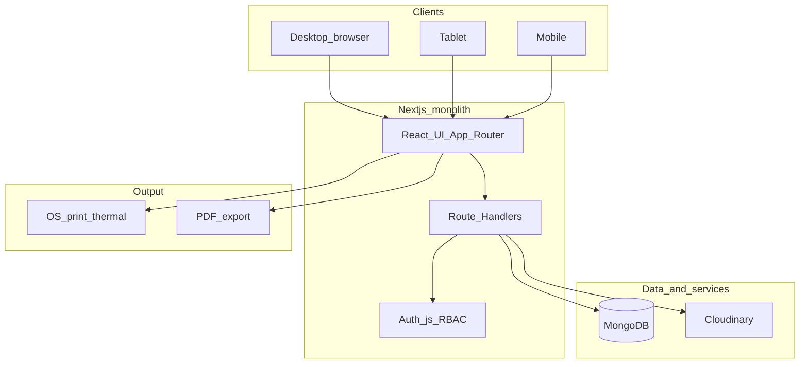

# Watch Shop POS — Phase One (MVP) Implementation Guide

**Version:** 1.0  
**Source document:** *POS System Proposal — MVP Phase* (5 pages)  
**Target stack:** Next.js App Router monolith (TypeScript), MongoDB (Mongoose), Cloudinary, local-first deployment  
**Workspace:** `watch-shop-pos`

---

## Table of contents

1. [How to use this guide](#1-how-to-use-this-guide)
2. [Commercial context (non-software)](#2-commercial-context-non-software)
3. [Complete Phase One requirements register](#3-complete-phase-one-requirements-register)
4. [Out of scope for Phase One](#4-out-of-scope-for-phase-one)
5. [Technical architecture](#5-technical-architecture)
6. [Database schema and indexes](#6-database-schema-and-indexes)
7. [API design](#7-api-design)
8. [Coding standards and patterns](#8-coding-standards-and-patterns)
9. [Modern UI/UX design system](#9-modern-uiux-design-system)
10. [Validation, errors, and feedback](#10-validation-errors-and-feedback)
11. [Security and performance](#11-security-and-performance)
12. [Testing strategy](#12-testing-strategy)
13. [Implementation stages (0–8)](#13-implementation-stages-08)
14. [Deployment, operations, and handover](#14-deployment-operations-and-handover)
15. [Master traceability checklist](#15-master-traceability-checklist)

---

## 1. How to use this guide

### 1.1 Purpose

This document is the **single source of truth** for building the Watch Repair & Sales Shop POS MVP. It translates every functional requirement from the proposal into architecture, data models, APIs, UI behavior, business rules, tests, and checklists.

### 1.2 Execution rules

1. **Complete stages in order** unless a stage explicitly allows parallel work. Later stages depend on auth, data models, and shared UI primitives from earlier stages.
2. **Do not skip acceptance criteria.** A stage is done only when its checklist is fully checked and relevant tests pass.
3. **One feature, fully integrated.** Avoid half-built modules (e.g. checkout without stock deduction or receipts).
4. **Local-first.** Develop against local MongoDB; bind the server to the LAN for tablet/phone testing.
5. **UI quality gate.** Before building screens in Stage 1+, install UI/UX Pro Max and generate a project-specific design system (see [Stage 0](#stage-0--project-foundation-and-design-tooling)).

### 1.3 Prerequisites (developer machine)

| Tool | Purpose |
|------|---------|
| Node.js 22+ | Next.js, tooling |
| npm or pnpm | Package management |
| MongoDB 7+ (local or Docker) | Primary database |
| Python 3.x | UI/UX Pro Max search scripts (optional but recommended) |
| Cloudinary account | Image uploads (logo, products, optional repair photos) |
| Git | Version control |

### 1.4 Environment variables (reference)

Create `.env.local` (never commit secrets):

```env
# App
NODE_ENV=development
NEXTAUTH_URL=http://localhost:3000
NEXTAUTH_SECRET=<generate-with-openssl-rand-base64-32>

# MongoDB
MONGODB_URI=mongodb://127.0.0.1:27017/watch-shop-pos

# Cloudinary (server-only secret)
CLOUDINARY_CLOUD_NAME=
CLOUDINARY_API_KEY=
CLOUDINARY_API_SECRET=

# Optional: bind for LAN access in production-like local runs
HOSTNAME=0.0.0.0
PORT=3000
```

---

## 2. Commercial context (non-software)

The proposal includes budget (LKR 65,000), milestone payments, timeline (~2.5 weeks), and a 30-day bug-fix warranty. **These are project-management terms, not application features.** Track them in your project plan separately.

**Software-relevant constraints from the proposal:**

- Offline-first / local operation on the shop PC (no recurring cloud hosting required for core POS).
- USB thermal printers (58mm/80mm) via standard OS printing.
- Windows-friendly deployment (browser-based app satisfies this on any OS with a browser).

---

## 3. Complete Phase One requirements register

Each requirement has an **ID**, **description**, **acceptance criteria**, and **implementation stage**.

### 3.1 Core Sales & Billing Module

| ID | Requirement | Acceptance criteria | Stage |
|----|-------------|---------------------|-------|
| SAL-01 | Fast checkout interface | Cashier completes a 3-item sale in ≤ 6 taps/clicks after items are found; layout is touch-friendly (min 44×44px targets) | 3 |
| SAL-02 | Search items by name | Typing partial name returns matching products in &lt; 300ms (local DB); selecting adds to cart | 3 |
| SAL-03 | Search items by SKU | Same search field matches SKU/barcode field; batteries/straps findable by code (e.g. CR2032) | 3 |
| SAL-04 | Category quick-buttons | Predefined categories visible on checkout; one tap filters product grid | 3 |
| SAL-05 | Thermal receipt (58mm/80mm) | Print dialog produces correctly sized receipt via CSS `@page` and print stylesheet; logo, shop contact, line items, discounts, thank-you note | 3 |
| SAL-06 | Digital PDF receipt | After sale, user can download/share PDF with same content as thermal receipt | 3 |
| SAL-07 | Line-item discount (flat) | Authorized role applies LKR amount off one line; total updates; receipt shows discount | 3 |
| SAL-08 | Line-item discount (%) | Authorized role applies 0–100% off one line; total updates; receipt shows discount | 3 |
| SAL-09 | Cart subtotal discount (flat) | Flat LKR off entire cart after line discounts; cannot exceed subtotal | 3 |
| SAL-10 | Cart subtotal discount (%) | Percentage off cart subtotal after line discounts | 3 |
| SAL-11 | Discount authorization | Admin and Cashier may apply discounts (per proposal); audit fields store who applied | 3 |
| SAL-12 | Payment: Cash | Select Cash; enter amount tendered; change calculated and shown; stored on sale | 3 |
| SAL-13 | Payment: Card | Select Credit/Debit Card; no change calculation; stored on sale | 3 |
| SAL-14 | Payment: Bank Transfer | Select Bank Transfer; stored on sale | 3 |
| SAL-15 | Stock on successful checkout | Inventory quantity decrements atomically with sale; insufficient stock blocks checkout | 3 |
| SAL-16 | Invoice immutability for Cashier | Cashier cannot delete invoices; Admin void only with reason and stock reversal | 3 |

### 3.2 Repair Job Management

| ID | Requirement | Acceptance criteria | Stage |
|----|-------------|---------------------|-------|
| REP-01 | Repair ticket fields | Capture: Customer Name, Phone, Watch Brand, Model, Issue Description, Estimated Cost | 4 |
| REP-02 | Unique Ticket ID | Auto-generated human-readable ID (e.g. `R-20261026-0042`); unique in DB | 4 |
| REP-03 | Status lifecycle | Pending → In Progress → Ready for Collection → Delivered; UI enforces valid transitions | 4 |
| REP-04 | Visual repair dashboard | Board/list of watches currently in shop (not Delivered); filter by status | 4 |
| REP-05 | Customer claim token print | Printable token with Ticket ID, estimate, terms & conditions, shop branding | 4 |
| REP-06 | Repair revenue for reporting | On Delivered, record payment (method + amount) so EOD splits retail vs repair | 4 |
| REP-07 | Cashier repair access | Cashier can create and update tickets and statuses per rules; cannot delete tickets | 4 |

### 3.3 Basic Inventory Management

| ID | Requirement | Acceptance criteria | Stage |
|----|-------------|---------------------|-------|
| INV-01 | Category tree | Seed: Men's Watches, Women's Watches, Smartwatches, Leather Straps, Metal Bracelets, Batteries | 2 |
| INV-02 | Battery attributes | Products in Batteries category support size/model attribute (e.g. CR2032) on product record | 2 |
| INV-03 | Real-time stock deduction | On completed sale, stock reduces immediately (same transaction as sale) | 3 |
| INV-04 | Admin stock add | Admin can increase quantity with reason/note | 2 |
| INV-05 | Admin write-off | Admin can decrease quantity (damaged/lost) with reason; cannot go negative | 2 |
| INV-06 | Cashier stock restriction | Cashier cannot directly modify inventory quantities | 2, 1 |
| INV-07 | Low stock alerts | Admin dashboard shows items where `quantity &lt; lowStockThreshold` with message like “Alert: CR2032 Batteries below 10 units” | 2, 6 |

### 3.4 Reporting & Dashboard Analytics

| ID | Requirement | Acceptance criteria | Stage |
|----|-------------|---------------------|-------|
| RPT-01 | Daily sales report (EOD) | For selected calendar day: total revenue | 5 |
| RPT-02 | Retail vs repair split | Same report clearly separates Retail Sales vs Repair Services income | 5 |
| RPT-03 | Cash drawer reconciliation | Workflow: opening float + cash sales − cash refunds/voids = expected; user enters counted cash; system shows shortage/overage | 5 |
| RPT-04 | Cashier shift cash total | Cashier dashboard shows current shift expected cash in drawer (cash sales only) | 5, 6 |

### 3.5 User Management & Security

| ID | Requirement | Acceptance criteria | Stage |
|----|-------------|---------------------|-------|
| SEC-01 | Admin role | Full access: inventory CRUD, all reports, staff accounts, shop settings | 1 |
| SEC-02 | Cashier role | Sales, repair tickets, view shift cash total; no invoice delete, no inventory qty edit | 1 |
| SEC-03 | Authentication | Login required for all POS routes; session secure (httpOnly cookies) | 1 |
| SEC-04 | RBAC on API | Every mutating API checks role; 403 for unauthorized | 1, 7 |
| SEC-05 | Staff management | Admin can create/disable users, assign role, reset password | 1 |

### 3.6 Cross-cutting (derived for production-ready MVP)

| ID | Requirement | Acceptance criteria | Stage |
|----|-------------|---------------------|-------|
| X-01 | Responsive UI | Usable on desktop, tablet, phone (checkout, repairs, admin) | 0–7 |
| X-02 | Shop settings | Name, address, phone, logo (Cloudinary), receipt thank-you text, repair T&C text | 1 |
| X-03 | Audit trail | Sales voids, stock adjustments, discount applications store user + timestamp | 3, 2 |
| X-04 | Health check | `GET /api/health` returns DB connectivity | 0, 14 |

---

## 4. Out of scope for Phase One

Do **not** implement unless explicitly added to a future phase:

- Repair parts consumption / BOM on tickets
- VAT/tax engine (optional `taxEnabled` flag in settings default `false`, no calculation in MVP)
- Customer CRM, loyalty, marketing
- Multi-branch / multi-warehouse
- Mandatory cloud hosting (Atlas/Vercel) for daily operation
- Silent ESC/POS raw USB (document as Phase 2 enhancement; MVP uses browser print + PDF)
- Features not listed in proposal sections 3.1–3.5

---

## 5. Technical architecture

### 5.1 High-level diagram



### 5.2 Architectural decisions

| Decision | Choice | Rationale |
|----------|--------|-----------|
| Monolith | Single Next.js app | Simpler deploy on one shop PC; matches budget |
| Money storage | Integer minor units (`amountCents`) | Avoid float errors in LKR |
| Transactions | MongoDB multi-document transactions | Sale + stock decrement atomic |
| Auth | Auth.js credentials provider | Local users, no external IdP required |
| Images | Cloudinary server upload | Professional product images; secret not in client |
| Offline | Core POS works without internet except new uploads | Matches local-first goal; cache images via `next/image` |

### 5.3 Folder structure

```
watch-shop-pos/
├── app/
│   ├── (auth)/
│   │   └── login/
│   │       └── page.tsx
│   ├── (pos)/
│   │   ├── layout.tsx              # Shell: nav, role-aware menu
│   │   ├── dashboard/
│   │   ├── checkout/
│   │   ├── sales/
│   │   │   └── [id]/
│   │   ├── repairs/
│   │   │   ├── page.tsx            # Board
│   │   │   ├── new/
│   │   │   └── [ticketId]/
│   │   ├── inventory/
│   │   │   ├── products/
│   │   │   └── adjustments/
│   │   ├── reports/
│   │   │   ├── daily/
│   │   │   └── reconciliation/
│   │   ├── shifts/
│   │   ├── settings/               # Admin
│   │   └── users/                  # Admin
│   ├── api/
│   │   ├── auth/[...nextauth]/
│   │   ├── health/
│   │   ├── categories/
│   │   ├── products/
│   │   ├── sales/
│   │   ├── repairs/
│   │   ├── stock-adjustments/
│   │   ├── shifts/
│   │   ├── reports/
│   │   ├── settings/
│   │   ├── users/
│   │   └── uploads/
│   ├── layout.tsx
│   └── globals.css
├── components/
│   ├── ui/                         # shadcn primitives
│   └── pos/                        # Domain components
├── lib/
│   ├── auth/
│   ├── db/
│   ├── rbac/
│   ├── money/
│   ├── validators/
│   ├── receipts/
│   └── cloudinary/
├── models/                         # Mongoose schemas
├── types/
├── scripts/
│   └── seed.ts
├── tests/
│   ├── unit/
│   ├── integration/
│   └── e2e/
├── docs/
│   └── MVP-PHASE-ONE-IMPLEMENTATION-GUIDE.md
├── .env.local.example
├── docker-compose.yml              # Optional: mongo only
└── package.json
```

### 5.4 Role-based navigation

| Route | Admin | Cashier |
|-------|-------|---------|
| Dashboard | Yes | Yes (limited widgets) |
| Checkout | Yes | Yes |
| Sales history | Yes | Yes (no void) |
| Repairs | Yes | Yes |
| Inventory products | Yes | Read-only list optional; no edit |
| Stock adjustments | Yes | No |
| Reports | Yes | No |
| Shifts / reconciliation | Yes | Open/close own shift |
| Settings / Users | Yes | No |

---

## 6. Database schema and indexes

All monetary fields: **integer `amountCents`** (LKR × 100). Display with `formatLkr(amountCents)`.

### 6.1 `users`

```ts
{
  _id, email (unique), name, passwordHash,
  role: 'admin' | 'cashier',
  isActive: boolean,
  createdAt, updatedAt
}
```

Indexes: `{ email: 1 }` unique.

### 6.2 `shopSettings` (singleton document `_id: 'shop'`)

```ts
{
  shopName, address, phone, email?,
  logoUrl?, logoCloudinaryId?,
  receiptThankYouNote: string,
  repairTermsAndConditions: string,
  defaultLowStockThreshold: number,
  receiptPaperWidth: '58mm' | '80mm',
  taxEnabled: boolean  // default false, unused in MVP totals
}
```

### 6.3 `categories`

```ts
{
  _id, name, slug, sortOrder, parentId?: ObjectId | null,
  isActive, createdAt, updatedAt
}
```

Seed six top-level categories per INV-01. Indexes: `{ slug: 1 }` unique, `{ sortOrder: 1 }`.

### 6.4 `products`

```ts
{
  _id, name, sku (unique), categoryId,
  priceCents, costCents?,  // cost optional for margin later
  quantity: number,
  lowStockThreshold: number,
  attributes: { batterySize?: string, brand?: string, ... },
  imageUrl?, imageCloudinaryId?,
  isActive, trackInventory: boolean,  // default true
  createdAt, updatedAt
}
```

Indexes: `{ sku: 1 }` unique, `{ name: 'text', sku: 'text' }`, `{ categoryId: 1 }`, `{ quantity: 1, lowStockThreshold: 1 }`.

### 6.5 `stockAdjustments`

```ts
{
  _id, productId, delta: number,  // + add, - write-off
  reason: 'purchase' | 'damage' | 'correction' | 'other',
  note?, performedBy: userId, createdAt
}
```

### 6.6 `sales` (invoices)

```ts
{
  _id, invoiceNumber: string,  // e.g. INV-20261026-0001
  status: 'completed' | 'voided',
  voidReason?, voidedBy?, voidedAt?,
  lineItems: [{
    productId, name, sku, quantity,
    unitPriceCents, lineDiscount?: { type: 'flat'|'percent', value, amountCents },
    lineTotalCents
  }],
  cartDiscount?: { type, value, amountCents },
  subtotalCents, discountTotalCents, totalCents,
  payments: [{ method: 'cash'|'card'|'bank_transfer', amountCents, tenderedCents?, changeCents? }],
  soldBy: userId, shiftId?,
  createdAt
}
```

Indexes: `{ invoiceNumber: 1 }` unique, `{ createdAt: -1 }`, `{ status: 1, createdAt: -1 }`.

### 6.7 `repairTickets`

```ts
{
  _id, ticketId: string,  // REP-02
  customerName, customerPhone,
  watchBrand, watchModel,
  issueDescription,
  estimatedCostCents,
  status: 'pending' | 'in_progress' | 'ready' | 'delivered',
  statusHistory: [{ status, changedBy, changedAt, note? }],
  payment?: { method, amountCents, paidAt, receivedBy },
  intakePhotoUrl?,  // optional Cloudinary
  createdBy, createdAt, updatedAt
}
```

Indexes: `{ ticketId: 1 }` unique, `{ status: 1, updatedAt: -1 }`, `{ customerPhone: 1 }`.

### 6.8 `shifts`

```ts
{
  _id, openedBy, openedAt, openingFloatCents,
  closedBy?, closedAt?,
  expectedCashCents?, countedCashCents?, varianceCents?,  // set on close
  status: 'open' | 'closed',
  notes?
}
```

Indexes: `{ status: 1 }`, `{ openedAt: -1 }`.

### 6.9 Counters collection (optional)

`counters: { _id: 'invoice' | 'repair', seq: number, dateKey }` for daily sequences.

---

## 7. API design

REST-style Route Handlers under `app/api`. All except `health` and auth require session.

### 7.1 Conventions

- **Success:** `{ data }` or `{ data, meta }`
- **Error:** `{ error: { code, message, details? } }` with HTTP 400/401/403/404/409/500
- **Pagination:** `?page=1&limit=20` → `meta: { page, limit, total }`
- **Idempotency:** Sale creation uses server-generated invoice number inside transaction

### 7.2 Endpoints

| Method | Path | Roles | Description |
|--------|------|-------|-------------|
| GET | `/api/health` | public | DB ping |
| POST | `/api/auth/*` | public | Auth.js |
| GET/PATCH | `/api/settings` | admin | Shop settings |
| GET/POST/PATCH/DELETE | `/api/users` | admin | Staff CRUD |
| GET/POST | `/api/categories` | admin write | Categories |
| GET/POST/PATCH | `/api/products` | admin write | Products |
| POST | `/api/uploads/image` | admin | Cloudinary signed upload |
| POST | `/api/stock-adjustments` | admin | Adjust stock |
| GET/POST | `/api/sales` | admin, cashier | List/create sales |
| POST | `/api/sales/[id]/void` | admin | Void invoice |
| GET/POST/PATCH | `/api/repairs` | admin, cashier | Tickets |
| GET/POST | `/api/shifts` | admin, cashier | Open shift |
| POST | `/api/shifts/[id]/close` | admin, cashier | Reconciliation |
| GET | `/api/reports/daily` | admin | EOD report |
| GET | `/api/reports/low-stock` | admin | Low stock list |

### 7.3 Sale creation flow (server)

1. Validate session and open shift (cashier must have open shift).
2. Validate line items, discounts, payment totals match `totalCents`.
3. Start MongoDB transaction.
4. For each line: if `trackInventory`, ensure `quantity >= sold qty`; decrement.
5. Insert `sales` document.
6. Commit.
7. Return sale with `invoiceNumber` for receipt.

### 7.4 Repair status transitions

| From | To (Cashier) | To (Admin) |
|------|----------------|------------|
| pending | in_progress | in_progress |
| in_progress | ready | ready, pending (one step back) |
| ready | delivered (requires payment) | delivered |
| delivered | — | — (locked) |

**Delivered:** `POST` body includes `payment: { method, amountCents }`; default `amountCents = estimatedCostCents` editable.

---

## 8. Coding standards and patterns

### 8.1 TypeScript

- Strict mode enabled.
- Shared types in `types/`; Zod schemas in `lib/validators/` mirror API inputs.

### 8.2 Server vs client

- Default to Server Components; use `"use client"` only for checkout cart, repair board drag/tap, print triggers, forms with instant validation.

### 8.3 Data fetching

- Server Components: direct DB or internal service functions.
- Client mutations: `fetch('/api/...')` with loading/error toasts (sonner).

### 8.4 Naming

- Files: kebab-case (`repair-ticket-card.tsx`).
- Components: PascalCase.
- API routes: plural resources.

### 8.5 Git workflow

- Feature branches per stage optional; commit messages: `feat(checkout): add cart discount`.

---

## 9. Modern UI/UX design system

### 9.1 UI/UX Pro Max setup (mandatory before UI build)

```bash
npm install -g ui-ux-pro-max-cli
cd watch-shop-pos
uipro init --ai cursor
```

Restart Cursor. Prompt example:

> Generate a design system for a luxury watch repair and retail POS: warm paper background, ink typography, champagne gold accent, high contrast for sunlight on shop counter, touch-first checkout, shadcn/ui + Tailwind Next.js App Router.

Store tokens in `app/globals.css` as CSS variables.

### 9.2 Design tokens (baseline)

| Token | Value (example) | Usage |
|-------|-----------------|--------|
| `--background` | `#F7F4EF` | Page background |
| `--foreground` | `#1A1814` | Primary text |
| `--primary` | `#B8956B` | Gold accent, primary buttons |
| `--primary-foreground` | `#1A1814` | Text on gold |
| `--card` | `#FFFFFF` | Panels |
| `--destructive` | `#B42318` | Errors, void |
| `--success` | `#0D7A4E` | Paid, in stock |
| `--radius` | `0.75rem` | Cards |
| Font display | `Cormorant Garamond` or similar | Headings, shop name on receipt |
| Font UI | `DM Sans` or `Inter` | UI body |

### 9.3 Layout patterns

| Screen | Desktop (≥1024px) | Tablet (768–1023px) | Mobile (&lt;768px) |
|--------|-------------------|---------------------|---------------------|
| Checkout | 60/40 product grid / cart | Sticky cart right | Bottom sheet cart FAB |
| Repair board | 4 Kanban columns | 2×2 grid | Tabs per status |
| Inventory | Data table + side drawer form | Full-width table | Card list |
| Reports | Charts + tables | Stacked | Stacked, export buttons full width |

### 9.4 Motion

- Page transitions: 150–200ms ease.
- Cart add: subtle scale on line item.
- Respect `prefers-reduced-motion`.

### 9.5 Accessibility

- WCAG 2.1 AA contrast for text.
- Focus rings visible on keyboard nav.
- `aria-live` for cart total and change due.

---

## 10. Validation, errors, and feedback

### 10.1 Zod rules (summary)

| Entity | Rules |
|--------|--------|
| Product | `name` 2–120 chars; `sku` unique; `priceCents >= 0`; `quantity >= 0` |
| Sale | `lineItems.length >= 1`; payment sum === total; cash `tenderedCents >= totalCents` |
| Discount flat | `amountCents <= applicable subtotal` |
| Discount % | `0 <= value <= 100` |
| Repair | `customerPhone` E.164 or local 9–10 digits; `estimatedCostCents >= 0` |
| User | email valid; password min 8 chars |

### 10.2 User-facing messages

| Code | Message |
|------|---------|
| `STOCK_INSUFFICIENT` | Not enough stock for {productName}. Available: {qty}. |
| `SHIFT_REQUIRED` | Open a shift before making a sale. |
| `UNAUTHORIZED` | You don't have permission for this action. |
| `INVALID_TRANSITION` | This status change isn't allowed. |
| `PAYMENT_MISMATCH` | Payment total must match sale total. |

### 10.3 UI states

Every list screen: **skeleton** loading, **empty** illustration + CTA, **error** retry button. Toasts on success: “Sale completed — INV-…”.

---

## 11. Security and performance

### 11.1 Security

- bcrypt (cost 12) for passwords.
- Auth.js session: `httpOnly`, `secure` in production, `sameSite: 'lax'`.
- RBAC middleware helper `requireRole(['admin'])` on every API route.
- Rate-limit login (e.g. 10/min per IP) via simple in-memory or Mongo collection.
- Sanitize user HTML in settings (DOMPurify) if rich text ever added; MVP plain text.
- Cloudinary upload: validate MIME (image/jpeg, png, webp), max 5MB.
- No secrets in client bundles; only `NEXT_PUBLIC_*` for non-sensitive values.

### 11.2 Performance

- Mongo indexes as in §6.
- Product search: text index + limit 50.
- Checkout product grid: paginate or virtualize if &gt; 100 items.
- `next/image` for Cloudinary URLs with sizes.
- API route handlers: reuse Mongoose connection singleton (`lib/db`).

### 11.3 Reliability

- Sale transaction retries not automatic; show error and let user retry.
- Log server errors with request id; no PII in logs.

---

## 12. Testing strategy

### 12.1 Tooling

| Layer | Tool |
|-------|------|
| Unit | Vitest (`money`, discount math, ticket id generator) |
| Integration | Vitest + mongodb-memory-server (API routes) |
| E2E | Playwright (login, checkout, repair flow) |

### 12.2 Coverage targets (MVP)

- 100% coverage on `lib/money` and discount calculator.
- Integration tests for: create sale + stock decrement, void restores stock, repair delivered + payment, shift reconciliation math.

### 12.3 E2E scenarios (acceptance)

1. Admin seeds product → Cashier opens shift → sells item cash → receipt page loads → stock -1.
2. Cashier creates repair → prints token → moves to Delivered with card payment → daily report shows repair revenue.
3. Cashier denied void and stock adjustment (403).
4. Low stock product appears on admin dashboard.

### 12.4 Running tests

```bash
npm run test          # unit + integration
npm run test:e2e      # playwright
```

---

## 13. Implementation stages (0–8)

---

### Stage 0 — Project foundation and design tooling

**Goal:** Runnable Next.js app, MongoDB connection, linting, health check, app shell, UI skill installed.

**Steps:**

1. `npx create-next-app@latest watch-shop-pos --typescript --tailwind --eslint --app --src-dir=false --import-alias "@/*"`
2. Add shadcn/ui: `npx shadcn@latest init` (New York style, CSS variables).
3. Install: `mongoose`, `next-auth@beta` (Auth.js v5), `bcryptjs`, `zod`, `sonner`, `@react-pdf/renderer` (or `jspdf` for PDF receipts).
4. `docker-compose.yml` with `mongo:7` on port 27017.
5. Implement `lib/db/mongoose.ts` connection cache.
6. `GET /api/health` → `{ status: 'ok', db: 'connected' }`.
7. Run `uipro init --ai cursor`; document design tokens in `globals.css`.
8. Build `(pos)/layout.tsx`: sidebar (desktop), bottom nav (mobile), placeholder pages.
9. Add `.env.local.example` and README quick start.

**Checklist:**

- [ ] `npm run dev` works
- [ ] Health check passes with Mongo running
- [ ] UI/UX Pro Max skill present under `.cursor/skills/`
- [ ] Responsive shell navigates between placeholder routes

---

### Stage 1 — Shop settings, users, login, RBAC

**Goal:** SEC-01–05, X-02.

**Backend:**

1. Models: `User`, `ShopSettings`.
2. Seed script: default admin `admin@shop.local` / temporary password (force change on first login optional).
3. Auth.js Credentials provider; session includes `userId`, `role`.
4. Middleware: protect `(pos)/*` → redirect to `/login`.
5. APIs: settings GET/PATCH, users CRUD (admin).

**Frontend:**

1. Login page: centered card, shop name, email/password, error states.
2. Settings page (admin): shop details, logo upload via `/api/uploads/image`, receipt note, repair T&C textarea.
3. Users page: table, create user dialog, deactivate toggle.

**RBAC:**

- `lib/rbac/permissions.ts` map actions → roles.
- Use in API and hide nav items for cashier.

**Checklist:**

- [ ] Admin can log in and update shop settings
- [ ] Admin can create cashier account
- [ ] Cashier login works; cannot access `/users` or `/settings`
- [ ] Unauthenticated users cannot access POS routes

---

### Stage 2 — Categories, products, inventory, Cloudinary

**Goal:** INV-01–02, INV-04–06, INV-07 (data layer), X-03 for adjustments.

**Backend:**

1. Models: `Category`, `Product`, `StockAdjustment`.
2. Seed six categories and sample products (watches, CR2032 battery).
3. `POST /api/stock-adjustments`: admin only; updates `product.quantity` in transaction; logs adjustment.
4. `GET /api/reports/low-stock` for admin.

**Frontend:**

1. Product list with search/filter by category.
2. Product form: name, SKU, category, price, qty, threshold, battery size when category is Batteries.
3. Image upload component (admin): calls server upload → Cloudinary → saves URL on product.
4. Adjustments page: select product, +/−, reason, note.

**Checklist:**

- [ ] Categories seeded per proposal
- [ ] Admin can CRUD products with image
- [ ] Stock adjustment increases/decreases qty with audit
- [ ] Cashier API returns 403 on adjustment
- [ ] Low-stock endpoint returns correct items

---

### Stage 3 — Checkout, discounts, payments, receipts

**Goal:** SAL-01–16, INV-03, X-03.

**Frontend (`app/(pos)/checkout`):**

1. **Product panel:** search (name + SKU), category chips, product cards with image/price/stock badge.
2. **Cart panel:** line qty steppers, per-line discount popover (flat/%), cart-level discount, subtotal/discount/total.
3. **Payment step:** method dropdown; cash shows tendered + change (live calc).
4. **Complete sale** → success modal with Print / Download PDF / New sale.

**Backend:**

1. `lib/money/calculate-sale-totals.ts` — unit tested.
2. `POST /api/sales` with transaction stock check.
3. Require open `shift` for cashier (link `shiftId`).
4. Invoice number generator.

**Receipts (`lib/receipts/`):**

1. `ReceiptThermal.tsx` — print-only CSS `@media print`, widths 58mm/80mm from settings.
2. `ReceiptPdfDocument.tsx` — `@react-pdf/renderer` download.
3. Content: logo, shop contact, invoice #, date, lines, discounts, payment, change, thank-you note.

**Void (admin):**

1. `POST /api/sales/[id]/void` — status voided, restore stock, record reason.

**Checklist:**

- [ ] Full sale flow with all three payment types
- [ ] Line and cart discounts on receipt
- [ ] Thermal print preview correct width
- [ ] PDF downloads locally
- [ ] Stock decrements atomically; blocked if insufficient
- [ ] Cashier cannot void

---

### Stage 4 — Repair tickets, board, claim token, delivery payment

**Goal:** REP-01–07.

**Backend:**

1. Model `RepairTicket`; ticket ID generator `R-YYYYMMDD-SEQ`.
2. APIs: create, list (filter status ≠ delivered for board), PATCH status, POST deliver with payment.

**Frontend:**

1. **New repair** form with validation.
2. **Board:** columns by status; card shows customer, brand/model, estimate; tap to detail.
3. **Detail:** timeline from `statusHistory`, actions (Advance status / Deliver & pay).
4. **Claim token print view** `/repairs/[ticketId]/token` — terms from settings, estimate, ticket ID, barcode optional (Code128 of ticketId).

**Checklist:**

- [ ] All required fields captured
- [ ] Unique ticket IDs
- [ ] Status transitions enforced
- [ ] Claim token prints correctly
- [ ] Delivery records payment for reports
- [ ] Cashier can create/update per rules

---

### Stage 5 — Shifts, daily report, cash reconciliation

**Goal:** RPT-01–04.

**Backend:**

1. Model `Shift`.
2. `POST /api/shifts` open (opening float); one open shift per cashier or shop-wide (choose **shop-wide single open shift** for simpler MVP — document in settings).
3. Close shift: compute `expectedCashCents = openingFloat + sum(cash sales) - sum(cash refunds/voids)` for shift window; accept `countedCashCents`; store variance.
4. `GET /api/reports/daily?date=YYYY-MM-DD`: aggregate `sales` (retail, non-voided) + `repairTickets` payments on that date by method; split retail vs repair.

**Frontend:**

1. Shift bar in header: “Open shift” / “Close shift” dialog with float and count.
2. Reports → Daily: date picker, totals cards, retail/repair split table, payment method breakdown.
3. Reconciliation view on close shift with shortage/overage highlight.

**Checklist:**

- [ ] Cannot sell without open shift (cashier)
- [ ] Expected cash formula documented and tested
- [ ] EOD report matches test transactions
- [ ] Cashier sees shift cash total on dashboard

---

### Stage 6 — Role-specific dashboards

**Goal:** INV-07 UI, RPT-04 UI, polish navigation.

**Admin dashboard:**

- Today revenue (retail + repair)
- Low stock widget with links to products
- Open repairs count by status
- Quick links: New product, Daily report

**Cashier dashboard:**

- Open shift status + expected cash
- Shortcuts: Checkout, New repair
- Today’s personal sales count (optional)

**Checklist:**

- [ ] Widgets load with real data
- [ ] Low stock alert text matches proposal style
- [ ] Role-specific layouts verified

---

### Stage 7 — Hardening: validation, a11y, security audit, performance

**Goal:** X-01, SEC-04, production polish.

**Tasks:**

1. Audit all forms with Zod + inline errors.
2. Empty states on all lists.
3. Keyboard navigation on checkout.
4. Review API routes for missing `requireRole`.
5. Add login rate limiting.
6. Lighthouse pass on checkout (performance &gt; 85 local).
7. Error boundary on POS layout.

**Checklist:**

- [ ] No API route without auth check except health/login
- [ ] All acceptance criteria messages implemented
- [ ] Reduced motion respected
- [ ] Mobile checkout usable one-handed

---

### Stage 8 — Automated tests and acceptance sign-off

**Goal:** §12 complete; map tests to requirement IDs.

**Tasks:**

1. Unit tests: money, discounts, expected cash, ticket/invoice ids.
2. Integration: sales, void, repairs, shifts.
3. Playwright: golden paths §12.3.
4. Create `docs/ACCEPTANCE-PHASE-ONE.md` checklist copied from §15 for stakeholder demo.

**Checklist:**

- [ ] `npm run test` green
- [ ] `npm run test:e2e` green
- [ ] Manual thermal print test on shop printer documented in handover

---

## 14. Deployment, operations, and handover

### 14.1 Local production run on shop PC

```bash
npm run build
npm run start -- -H 0.0.0.0 -p 3000
```

Access from tablet: `http://<PC_LAN_IP>:3000`.

Optional: install MongoDB as Windows service; PM2 or `nssm` to run Node on boot.

### 14.2 MongoDB backup

Daily script (Task Scheduler / cron):

```bash
mongodump --uri="mongodb://127.0.0.1:27017/watch-shop-pos" --out="D:\pos-backups\%DATE%"
```

Document restore: `mongorestore`.

### 14.3 Printer setup

1. Install thermal printer USB driver; set as default or select in print dialog.
2. In app Settings, set paper width 58mm or 80mm.
3. Test print from completed sale; adjust CSS margins if clipped.

### 14.4 Cloudinary

- Create upload preset folder `watch-shop-pos`.
- If internet down: sales still work; product images show broken/placeholder unless cached.

### 14.5 Monitoring

- Health endpoint polled every 5 min (optional script).
- Log file rotation for Node stdout.

### 14.6 Staff training outline (30–60 min)

1. Login / logout
2. Open shift → checkout → print receipt
3. Create repair → print claim token → update status → deliver & pay
4. Admin: add stock, run EOD report, close shift reconciliation
5. Void procedure (admin only)

### 14.7 Troubleshooting

| Issue | Check |
|-------|--------|
| Cannot connect from tablet | Firewall allows port 3000; server bound to 0.0.0.0 |
| DB connection failed | Mongo service running; `MONGODB_URI` |
| Upload fails | Cloudinary keys; internet |
| Print clipped | Paper width setting; browser print margins |
| Sale blocked | Open shift; stock levels |

---

## 15. Master traceability checklist

Use this when demoing Phase One. Map each proposal bullet to verification.

### Proposal §3.1 Core Sales & Billing

| Proposal bullet | Req ID | Stage | Verified |
|-----------------|--------|-------|----------|
| Fast checkout, touch-friendly UI | SAL-01 | 3 | [ ] |
| Search items by name | SAL-02 | 3 | [ ] |
| Search/select watches, straps, batteries, accessories quickly | SAL-01, SAL-04 | 3 | [ ] |
| Categorized quick-buttons | SAL-04 | 3 | [ ] |
| Thermal 58/80mm, logo, contact, items, discounts, thank-you | SAL-05 | 3 | [ ] |
| Digital PDF receipt export | SAL-06 | 3 | [ ] |
| Custom discounts flat & % | SAL-07–10 | 3 | [ ] |
| Discounts by Admin/Cashier | SAL-11 | 3 | [ ] |
| Line vs cart discount | SAL-07–10 | 3 | [ ] |
| Payment: Cash, Card, Bank Transfer | SAL-12–14 | 3 | [ ] |
| Cash change calculation | SAL-12 | 3 | [ ] |
| Search/SKU (advanced) | SAL-03 | 3 | [ ] |

### Proposal §3.2 Repair Job Management

| Proposal bullet | Req ID | Stage | Verified |
|-----------------|--------|-------|----------|
| Fields: name, phone, brand, model, issue, estimate | REP-01 | 4 | [ ] |
| Unique Ticket ID | REP-02 | 4 | [ ] |
| Status: Pending → In Progress → Ready for Collection → Delivered | REP-03 | 4 | [ ] |
| Visual dashboard of watches in shop | REP-04 | 4 | [ ] |
| Claim receipt with T&C, estimate, Ticket ID | REP-05 | 4 | [ ] |
| Repair income in reports | REP-06 | 4, 5 | [ ] |

### Proposal §3.3 Basic Inventory

| Proposal bullet | Req ID | Stage | Verified |
|-----------------|--------|-------|----------|
| Categories: Men's, Women's, Smartwatches, Leather Straps, Metal Bracelets, Batteries | INV-01 | 2 | [ ] |
| Batteries categorized by size/model (e.g. CR2032) | INV-02 | 2 | [ ] |
| Stock deduct on checkout | INV-03 | 3 | [ ] |
| Admin manual add / write-off | INV-04–05 | 2 | [ ] |
| Low stock alerts on admin dashboard | INV-07 | 2, 6 | [ ] |

### Proposal §3.4 Reporting

| Proposal bullet | Req ID | Stage | Verified |
|-----------------|--------|-------|----------|
| Daily sales report EOD | RPT-01 | 5 | [ ] |
| Split retail vs repair | RPT-02 | 5 | [ ] |
| Cash drawer reconciliation | RPT-03 | 5 | [ ] |

### Proposal §3.5 User Management & Security

| Proposal bullet | Req ID | Stage | Verified |
|-----------------|--------|-------|----------|
| Admin full access | SEC-01 | 1 | [ ] |
| Cashier: process sales, create/update repair tickets | SEC-02, REP-07 | 1, 4 | [ ] |
| Cashier: view current shift's cash total | RPT-04 | 5, 6 | [ ] |
| Cashier: cannot delete invoices | SAL-16 | 3 | [ ] |
| Cashier: cannot modify inventory quantities directly | INV-06 | 2 | [ ] |
| Admin: add/edit/delete inventory, all reports, staff, settings | SEC-01 | 1 | [ ] |
| RBAC | SEC-04 | 1, 7 | [ ] |

### Proposal §4 Technical (adapted stack)

| Proposal bullet | Implementation | Verified |
|-----------------|----------------|----------|
| Local PC / Node | Next.js on shop PC, LAN | [ ] |
| Database | MongoDB local | [ ] |
| Thermal printer | Browser print CSS | [ ] |
| Standard monitor / responsive | X-01 | [ ] |

---

## Appendix A — Discount calculation pseudocode

```
function lineTotal(item):
  base = item.unitPriceCents * item.quantity
  if item.lineDiscount:
    if item.lineDiscount.type == 'flat':
      return max(0, base - item.lineDiscount.amountCents)
    if item.lineDiscount.type == 'percent':
      return round(base * (100 - value) / 100)
  return base

subtotal = sum(lineTotal for each item)
cartDiscountAmount = apply(cartDiscount, subtotal)
total = subtotal - cartDiscountAmount
```

---

## Appendix B — Expected cash formula

```
expectedCash =
  shift.openingFloatCents
  + sum(sale.payments where method=cash and sale in shift window and status=completed)
  - sum(refunds/voids that returned cash in shift window)
```

Card and bank transfer do not affect drawer expected cash.

---

## Appendix C — Suggested package.json scripts

```json
{
  "scripts": {
    "dev": "next dev",
    "build": "next build",
    "start": "next start",
    "lint": "next lint",
    "seed": "tsx scripts/seed.ts",
    "test": "vitest run",
    "test:watch": "vitest",
    "test:e2e": "playwright test"
  }
}
```

---

## Appendix D — Document history

| Version | Date | Notes |
|---------|------|-------|
| 1.0 | 2026-10-26 | Initial Phase One guide from MVP proposal + Next.js/MongoDB/Cloudinary stack |

---

*End of implementation guide. Proceed to Stage 0 when ready to build.*
