# LUMINA — System User Guide

**Retail and repair point of sale**

This guide explains every screen, control, and day-to-day job in LUMINA. After you read the chapter for a task, you should be able to do that task on your own.

The pictures were taken from the running shop. Prices and counts in the pictures are sample data. The shop name on screen is **LUMINA**.

Installing the shop computer is covered in [SHOP-PC-DEPLOYMENT.md](SHOP-PC-DEPLOYMENT.md). This book is for the people who use the system after it is running.

---

## Contents

1. [What this system does](#1-what-this-system-does)
2. [Words used in this guide](#2-words-used-in-this-guide)
3. [Who can do what](#3-who-can-do-what)
4. [Signing in and signing out](#4-signing-in-and-signing-out)
5. [The workspace](#5-the-workspace)
6. [The cash drawer (shift)](#6-the-cash-drawer-shift)
7. [Home](#7-home)
8. [Checkout](#8-checkout)
9. [Sales and receipts](#9-sales-and-receipts)
10. [Repairs](#10-repairs)
11. [Inventory](#11-inventory)
12. [Categories](#12-categories)
13. [Stock adjustments](#13-stock-adjustments)
14. [Expenses](#14-expenses)
15. [Expense types](#15-expense-types)
16. [Daily report](#16-daily-report)
17. [Staff](#17-staff)
18. [Shop settings](#18-shop-settings)
19. [A full shop day](#19-a-full-shop-day)
20. [Messages, problems, and questions](#20-messages-problems-and-questions)

---

## 1. What this system does

LUMINA is the counter system for this watch shop. It both **sells** goods and **repairs** watches.

It keeps five kinds of work in one place:

| Work | What it is for |
|---|---|
| Retail sales | Ring up watches, straps, batteries, and other shop goods. Print or save a receipt. |
| Repairs | Take a watch in, print a claim slip, move the job through the bench, and record payment when the customer collects it. |
| Inventory | See what is on the shelf, add products, and (for an admin) correct quantities. |
| Expenses | Record money the shop spent, such as lunch, fuel, rent, or the electricity bill. |
| End of day | Count the cash drawer and read the daily report. |

Money is shown in **Sri Lankan rupees (LKR)**. The business day used by Home, expenses, and the daily report is **Sri Lanka time (Asia/Colombo)**. A sale made at 12:30 a.m. still belongs to the new Colombo date, even if someone thinks of it as “last night.”

The shop computer should be set to Sri Lanka time. Invoice numbers and repair ticket numbers use the date on that computer. The daily report uses the Colombo date. When the computer clock is set to Sri Lanka, those dates match.

There is **no sales tax** on the ticket. The total is the shelf price minus any discount you apply.

There are two kinds of login: **Admin** and **Cashier**. A person labelled “technician” on the sample data is still a cashier. There is no third role.

---

## 2. Words used in this guide

| Word | Meaning |
|---|---|
| SKU | The short stock code printed on the product, such as `WCH-M-CLASSIC`. It is unique. The system saves it in capital letters. |
| Ticket (checkout) | The list of items the customer is buying right now. It is not saved until you press **Complete sale**. |
| Invoice | The saved sale. Its number looks like `INV-20261116-0101`. |
| Shift | The time the cash drawer is open. You open it with a starting amount of cash and close it by counting the cash. |
| Opening float | The cash already in the drawer when you open the shift. |
| Expected cash | The amount the system thinks should be in the drawer. |
| Variance | Counted cash minus expected cash. A positive number means the drawer is over. A negative number means it is short. |
| Void | Cancel a completed invoice. Stock goes back on the shelf. The invoice stays in the list, marked voided. |
| Claim token | The paper slip you give the customer when they leave a watch for repair. They bring it back when they collect the watch. |
| Low stock | The quantity on hand is **at or equal to** the alert level, or below it. Example: alert 10 and quantity 10 is already low stock. |
| Active | The product or category is offered. An inactive product is hidden from checkout. Past sales that used it stay in history. |
| Business day | The Colombo calendar date, written as a normal date such as 16 November 2026. |

---

## 3. Who can do what

Everyone who can sign in can sell, take repairs, look at inventory, and record expenses. An **admin** can also change the catalog, void a sale, delete an expense, run the daily report, and manage staff and shop settings.

A cashier who types an admin address into the browser is sent back to Home. The menu simply hides those items.

### Pages

| Screen | Menu name | Admin | Cashier |
|---|---|---|---|
| Home | Home | Yes | Yes |
| Checkout | Checkout | Yes | Yes |
| Sales list and receipt | Sales | Yes | Yes |
| Repairs, new ticket, claim slip | Repairs | Yes | Yes |
| Expenses | Expenses | Yes | Yes |
| Inventory list and product page | Inventory | Yes | Yes (view) |
| Add or edit a product | — | Yes | No. The add page says “Only admins can add products.” |
| Categories | Categories | Yes | No |
| Stock adjustments | Stock | Yes | No |
| Daily report | Reports | Yes | No |
| Shop settings | Settings | Yes | No |
| Staff | Staff | Yes | No |
| Expense types | Manage types | Yes | No |

### Actions that differ by role

| Action | Admin | Cashier |
|---|---|---|
| Open and close the cash drawer | Yes | Yes |
| Complete a sale, including discounts | Yes | Yes |
| Print, share, or download a receipt | Yes | Yes |
| Void an invoice | Yes | No. The receipt says “Cashiers cannot void.” |
| Create and move a repair, including collection payment | Yes | Yes |
| Edit repair details after the watch is delivered | Yes | No |
| Add and edit an expense | Yes | Yes |
| Delete an expense | Yes | No |
| Add, edit, or remove a product | Yes | No |
| Change stock with a reason | Yes | No |
| See the low-stock list on Home | Yes | No |
| Create staff, change a password, turn a login off | Yes | No |
| Change the shop name, receipt text, paper width, or logo | Yes | No |

A role change takes effect the **next time that person signs in**. If you promote a cashier to admin while they are still signed in, ask them to log out and log in again.

---

## 4. Signing in and signing out

Open the shop address in the browser. If you are not signed in, you land on the sign-in page. If you are already signed in, you land on Home.

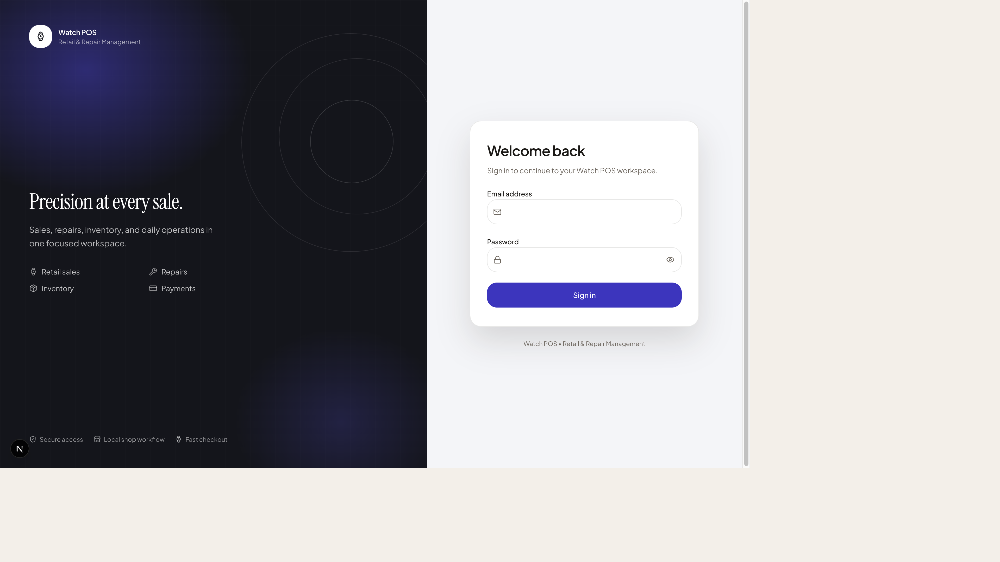

### What you see

The left panel is the shop brand: **LUMINA**, **Retail & Repair Management**, and the line **Precision at every sale.** It lists Retail sales, Repairs, Inventory, and Payments.

The form on the right:

| Control | What to do |
|---|---|
| Email address | Type the email an admin created for you. This is your username. |
| Password | Type the password. |
| Eye icon | **Show password** or **Hide password**. |
| Sign in | Checks the email and password, then opens Home. While it works, the button reads **Signing in**, then **Signed in**. |

If Caps Lock is on, the form shows **Caps Lock is on.**

### Sample logins

These accounts exist only after the demo data has been loaded. **Change the passwords before the shop goes live.** They are not production passwords.

| Person | Role in the system | Email | Password |
|---|---|---|---|
| Shop Admin | Admin | `admin@shop.local` | `Admin@12345` |
| Front Counter | Cashier | `cashier@shop.local` | `Cashier@12345` |
| Bench Technician | Cashier | `tech@shop.local` | `Tech@12345` |

### How to sign in

1. Click **Email address** and type the email.
2. Click **Password** and type the password.
3. Press **Sign in**.
4. Home opens. Your name and role appear at the bottom of the left menu.

If you were sent to sign-in because a page asked you to log in, you return to that page after a successful sign-in.

### Messages on this screen

| Message | What it means | What to do |
|---|---|---|
| Invalid email or password | The email is unknown, or the password is wrong. The system does not say which one. | Check the spelling. Ask an admin to reset the password if you are locked out of your own memory of it. |
| This account is inactive. Ask an admin to restore access. | An admin turned this login off. | An admin opens Staff, edits the person, and ticks **Active login**. |
| Unable to sign in. Try again. | The shop computer could not finish the sign-in. | Wait a moment and try again. If it continues, the person who looks after the shop computer should check that the system is running. |

### How to sign out

1. At the bottom of the left menu, press **Log out**.
2. You return to the sign-in page.

Signing out does not close the cash drawer. The shift stays open until someone closes it.

---

## 5. The workspace

After sign-in, every screen shares the same frame: a dark menu on the left, a bar across the top, and the page in the middle.

### Left menu

The watch icon at the top returns to Home. Under it the menu is in three groups.

**Counter** (everyone)

- **Home** — today’s snapshot
- **Checkout** — ring a sale
- **Sales** — find an old invoice
- **Repairs** — the repair bench
- **Expenses** — money the shop spent

**Catalog**

- **Inventory** — everyone
- **Categories** — admin
- **Stock** — admin

**Shop**

- **Reports** — admin
- **Settings** — admin
- **Staff** — admin

The current page is highlighted. On a wide screen, **Collapse** shrinks the menu to icons. Press it again to show the words.

On a phone or a narrow window the menu is hidden. Press the button labelled **Open menu** (the hamburger) to slide it out. **Close** puts it away. Choosing a page also closes it.

At the bottom of the menu:

- A circle with your initials, your name, and **admin** or **cashier**
- **Collapse**
- **Log out**

### Top bar

| Control | What it does |
|---|---|
| Back | Goes to the previous LUMINA page you opened, the same way a browser Back button does. It is disabled on the first page of the session. |
| Forward | Returns to a page you left with Back. |
| Search products | Finds a product and opens Checkout with that search. You can also press **⌘K** on a Mac or **Ctrl+K** on Windows to jump into this box. |
| Shift button | Opens or closes the cash drawer. See [Chapter 6](#6-the-cash-drawer-shift). On a narrow screen it sits under the page instead of in the top bar. |
| Bell | **Notifications**. Today this only tells you **No new alerts**. It does not list low stock or open repairs. Those are on Home. |
| New sale | Opens Checkout. Hidden on a very narrow screen; use the Checkout menu item instead. |

Messages such as “Sale completed” appear briefly at the top centre of the screen. They disappear on their own.

---

## 6. The cash drawer (shift)

A sale cannot be completed until a shift is open. The button in the top bar is the drawer.

- When the drawer is closed, the button reads **No open shift — tap to open**.
- When it is open, the button reads **Shift open** and shows the cash the system expects in the drawer, for example **Shift open LKR 26,000.00**.

There is **one open shift for the whole shop**, not one per person. If a cashier already opened the drawer, an admin sees the same open shift. A second person cannot open another one. The message is **A shift is already open**.

Card payments and bank transfers never change the cash figure. Only cash does.

### What “expected cash” includes

```
opening float
+ cash taken on completed sales during this shift
+ cash taken when a repair is collected during this shift
− cash from sales that were voided during this shift
```

Repair cash is included by the time it was paid, while this shift is open. It is not tied to which person opened the drawer.

### Open the drawer

1. Press **No open shift — tap to open**.
2. In **Open shift**, type the **Opening float (LKR)**. This is the notes and coins already in the drawer. Use `0` if the drawer is empty.
3. Press **Open shift**.

You see **Shift opened**. The button then shows the expected cash, which starts as the float you typed.

If the float is negative, the system refuses it: **Invalid opening float**.

### Close the drawer and count the cash

Do this at the end of the day, or whenever you want to lock the drawer. You can still look at old sales after the shift is closed. You cannot ring a new sale until someone opens a shift again.

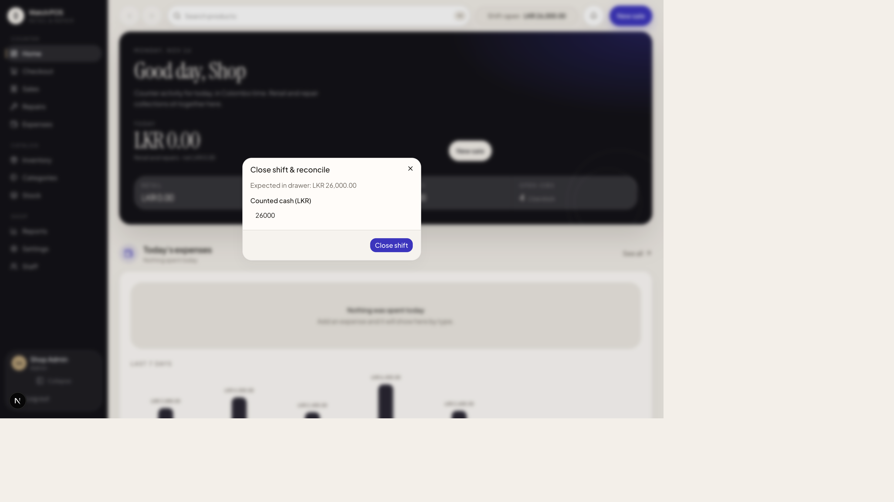

1. Press the **Shift open** button.
2. Read **Expected in drawer**. That is the amount the system calculated.
3. Count the notes and coins. Type that count in **Counted cash (LKR)**. The box starts filled with the expected amount, so a balanced drawer can be closed without retyping.
4. Press **Close shift**.

| Result | Message |
|---|---|
| The count matches | **Shift closed — drawer balanced** |
| The count is different | **Shift closed — variance** and the difference in rupees |

Variance is **counted minus expected**.

- Counted LKR 26,200 and expected LKR 26,000 → variance **+200** (over).
- Counted LKR 25,800 and expected LKR 26,000 → variance **−200** (short).

The daily report includes this variance for every shift **closed** on that Colombo date. If nobody closed a shift that day, the report has no variance figure.

**Close** (the small ×) leaves the shift open and does not save a count.

---

## 7. Home

Home is the first page after sign-in. It answers “what happened today?” in Colombo time.

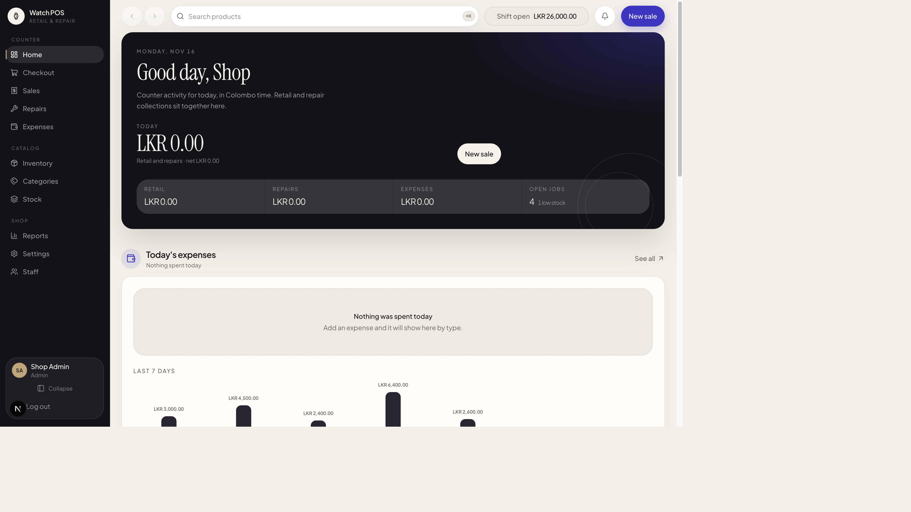

The greeting is **Good day,** plus the first word of your name. Under it: **Counter activity for today, in Colombo time. Retail and repair collections sit together here.**

### The dark summary card

| Item | Meaning |
|---|---|
| Date line | Today’s weekday and date, for example Monday, Nov 16. |
| Today | Retail sales **plus** repair collections for today. Voided sales are not included. |
| Retail and repairs · net | That same total **minus today’s expenses**. |
| New sale | Opens Checkout. |
| Retail | Completed retail sales today. |
| Repairs | Repair money collected today (watches marked delivered and paid today). |
| Expenses | Money recorded as spent today. |
| Open jobs | Repair tickets that are not yet delivered. Under the number, an admin sees **N low stock** or **stock healthy**. |

### Today’s expenses

Shows how today’s spending splits by type, and a **Last 7 days** chart. **See all** opens Expenses.

If nothing was spent today, the card says **Nothing was spent today** and **Add an expense and it will show here by type.** A day with no spending is drawn as a dash on the 7-day chart.

### My activity

A 7-day chart of **retail** sales (not repairs), with the week’s retail total beside the title. **See all** opens the daily report. A cashier who presses it is returned to Home, because reports are admin-only.

### Low stock (admin only)

**Items at or below their alert level.** Each row shows the product name, SKU, the alert level, and the quantity. Click a row to open the product. **See all** opens Inventory already filtered to low stock.

Cashiers do not see this block.

### Open repairs

Watches still in the shop: ticket number, brand and model, status, customer, and the estimate. Click a card to open the ticket. **See all** opens the repair board.

If the bench is clear: **No watches in the shop** / **New repair tickets will show up here.**

### Shortcuts

**Jump to common tasks.** Each tile has **Open →**.

| Tile | Where it goes |
|---|---|
| Men's watches | Inventory filtered to the men’s watches category, when that category exists |
| Straps & bracelets | The full inventory list |
| Repair bench | Repairs |

---

## 8. Checkout

Checkout is where you sell something that is already in inventory. Repairs are not rung up here. Repair money is recorded on the repair ticket when the customer collects the watch.

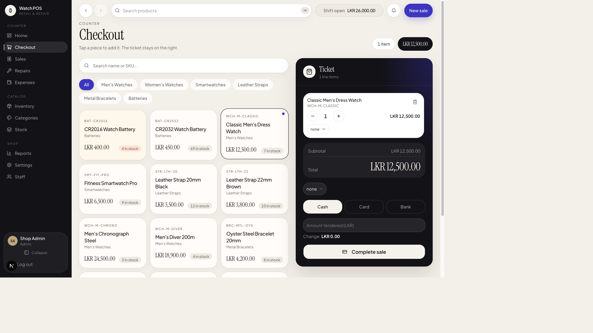

The page title is **Checkout**. The line under it says **Tap a piece to add it. The ticket stays on the right.** Two badges show how many items are on the ticket and the running total.

You need an **open shift** before **Complete sale** will succeed. You can still build the ticket while the shift is closed; the sale is refused at the last step with **Open a shift before making a sale.**

### Find a product

| Control | What it does |
|---|---|
| Search name or SKU… | Narrows the grid as you type. |
| Category pills | **All**, then one pill per active category (Men's Watches, Batteries, and so on). |
| Product card | Tap it to add one unit. The card shows SKU, name, category, price, and **N in stock**. A low-stock count is highlighted. A card already on the ticket gets a small coloured dot. |
| Prev / page numbers / Next | Moves through the catalog. Twelve products are shown at a time. |

If nothing matches: **No products match your search.** While the list is loading: **Loading products…**

The top-bar search does the same job. Type a name, press Enter, and Checkout opens with that search filled in.

Inactive products do not appear here.

### The ticket

| Control | What it does |
|---|---|
| Trash icon | Removes that line. |
| − and + | Changes the quantity. Quantity cannot go below 1; use the trash icon to remove the line. |
| Line discount | **No line discount**, **Flat LKR**, or **Percent %**. Then type the rupee amount or the percent. |
| Subtotal | The sum of the lines **after** each line’s own discount. |
| Discount | Shown only when a discount exists. This figure is the **line discounts plus the cart discount**. |
| Total | What the customer pays. |
| Cart discount | **No cart discount**, **Flat LKR**, or **Percent %**, applied to the subtotal. |
| Cash / Card / Bank | The payment method. One method per sale. |
| Amount tendered (LKR) | Cash only. What the customer handed you. |
| Change | Cash only. Tendered minus the total. It never goes below zero on screen. |
| Complete sale | Saves the invoice, reduces stock, and opens the receipt. While it saves, the button reads **Processing…**. It stays disabled while the ticket is empty. |

An empty ticket says **Your cart is empty.**

### How discounts are calculated

Worked example. One Classic Men's Dress Watch at **LKR 12,500.00**.

1. Choose **Percent %** on the line and type `10`. The line becomes **LKR 11,250.00**.
2. Choose **Flat LKR** on the cart and type `250`.
3. **Subtotal** shows **LKR 11,250.00** (already after the 10%).
4. **Discount** shows **LKR 1,500.00** (the LKR 1,250 line discount **plus** the LKR 250 cart discount).
5. **Total** shows **LKR 11,000.00**.

Subtotal minus the Discount line is **not** the total when a line discount exists, because the subtotal is already reduced and the Discount line still mentions that reduction. Trust **Total**.

A percent is limited to 0–100. A flat discount cannot take a line, or the whole sale, below zero. A percent discount is rounded to the nearest cent.

Both cashiers and admins may discount. The receipt records who applied it.

### Cash, card, and bank

- **Cash.** Type the amount the customer gave you. Change is shown immediately. If you leave the box empty, the system treats the payment as exact and the change is zero. If you type less than the total, the sale is refused: **Insufficient cash tendered**.
- **Card.** No tendered box. The card amount is the total.
- **Bank.** A bank transfer. It does not go into the cash drawer.

### What Complete sale does

1. Checks that a shift is open.
2. Checks that each tracked product has enough stock.
3. Lowers the quantity on hand.
4. Gives the sale a number such as `INV-20261116-0101`.
5. Attaches the sale to the open shift.
6. Shows **Sale completed —** and the invoice number, then opens the receipt.

You can put more units on the ticket than the badge says are in stock. The sale stops at the last step with **Not enough stock for {name}. Available: {n}.** Lower the quantity or take the line off.

### A sale from start to finish

Example: a customer buys one leather strap at LKR 3,500 and pays LKR 4,000 in cash.

1. Confirm the top bar says **Shift open**. If it does not, open a shift first.
2. Open **Checkout**.
3. Press the **Leather Straps** pill, or search `STR-LTH-20`.
4. Tap **Leather Strap 20mm Black**. The ticket shows quantity 1 and **LKR 3,500.00**.
5. Leave discounts on **none**.
6. Leave **Cash** selected.
7. Type `4000` in **Amount tendered**. **Change** shows **LKR 500.00**.
8. Press **Complete sale**.
9. On the receipt, press **Print receipt** if the customer wants paper.

Stock for that strap drops by 1. Expected cash in the drawer rises by LKR 3,500 (the sale total), not by the LKR 4,000 the customer handed over. The LKR 500 change is assumed to have been given back.

---

## 9. Sales and receipts

### Sales list

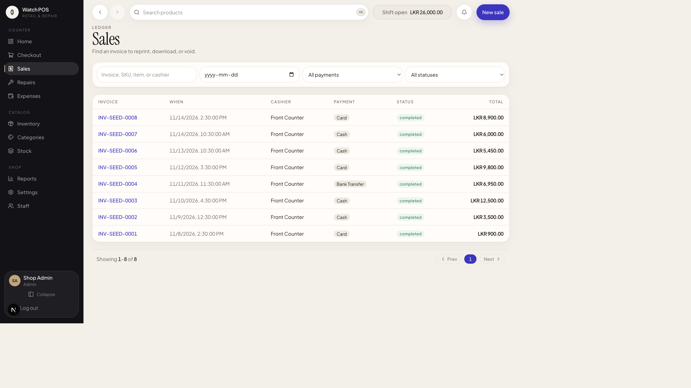

**Sales** is the ledger. The subtitle is **Find an invoice to reprint, download, or void.**

| Control | What it does |
|---|---|
| Invoice, SKU, item, or cashier | Text search. |
| Date | Limits the list to one calendar day. |
| All payments | **Cash**, **Card**, or **Bank transfer**. |
| All statuses | **Completed** or **Voided**. |
| Invoice number | Opens that receipt. |
| Prev / pages / Next | Moves through the list. The footer reads **Showing 1–8 of 8** (your numbers will differ). |

Columns are **Invoice**, **When**, **Cashier**, **Payment**, **Status**, and **Total**.

If nothing matches: **No sales match these filters.** Clear the search and the date, and set both menus back to **All**.

### Receipt

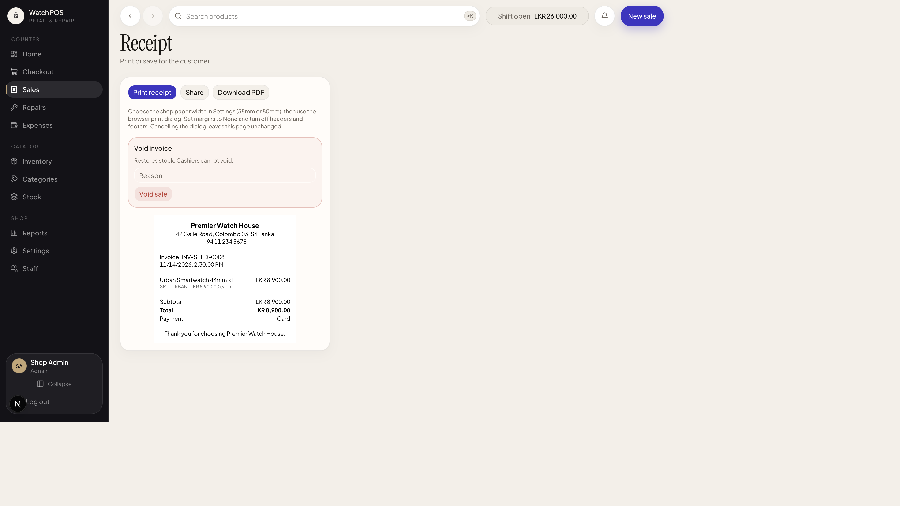

The page title is **Receipt**. The subtitle is **Print or save for the customer.**

| Button | What it does |
|---|---|
| Print receipt | Opens the browser print window. The receipt is laid out for the paper width chosen in Settings (58mm or 80mm). |
| Share | Tries to share the PDF. If the browser cannot share a file, it copies the receipt link and says **Receipt link copied. Use Download PDF if sharing files is unavailable.** If sharing is not available at all: **Use Download PDF to share this receipt.** |
| Download PDF | Saves a PDF of this invoice. |

Printing advice, also printed on the page: set the browser margins to **None**, and turn **headers and footers** off. Cancelling the print window does nothing to the sale.

The receipt itself shows:

- Shop name, address, and phone (and the logo, if one was uploaded)
- **Invoice** number and date
- Each line: name, quantity, SKU, price each, and a line discount if there was one
- **Subtotal**, **Discount** (if any), **Total**
- **Payment**, and for cash **Tendered** and **Change**
- **Discount applied by** the staff member, when a discount was used
- The thank-you note from Settings

A voided invoice prints **VOIDED** and the reason.

### Void an invoice (admin)

Under the buttons, admins see **Void invoice** and the hint **Restores stock. Cashiers cannot void.**

1. Open the receipt.
2. Type a reason. Example: `Customer returned the strap, unworn.`
3. Press **Void sale**. The button reads **Voiding…** while it works.

| Message | Meaning |
|---|---|
| Enter a reason to void this invoice | The reason box was empty. |
| Invoice voided and stock restored | Done. Quantities go back up for products that track stock. |
| Sale already voided | Someone already voided it. |
| Void failed | The void did not save. Read the message and try again. |

Voiding does not delete the invoice. It stays on the Sales list with status **voided**. The cash drawer expected total drops by the cash amount of that sale if the void happens during the shift. Card and bank voids do not change the drawer. The daily report counts the void on the day it was voided, and it does **not** keep the voided total inside Retail.

You cannot undo a void in the screen. Ring a new sale if the customer buys the item again.

---

## 10. Repairs

A repair is a watch the customer leaves with you. It is not a product sale. The estimate is a quote. The money is recorded only when you mark the watch delivered.

### The board

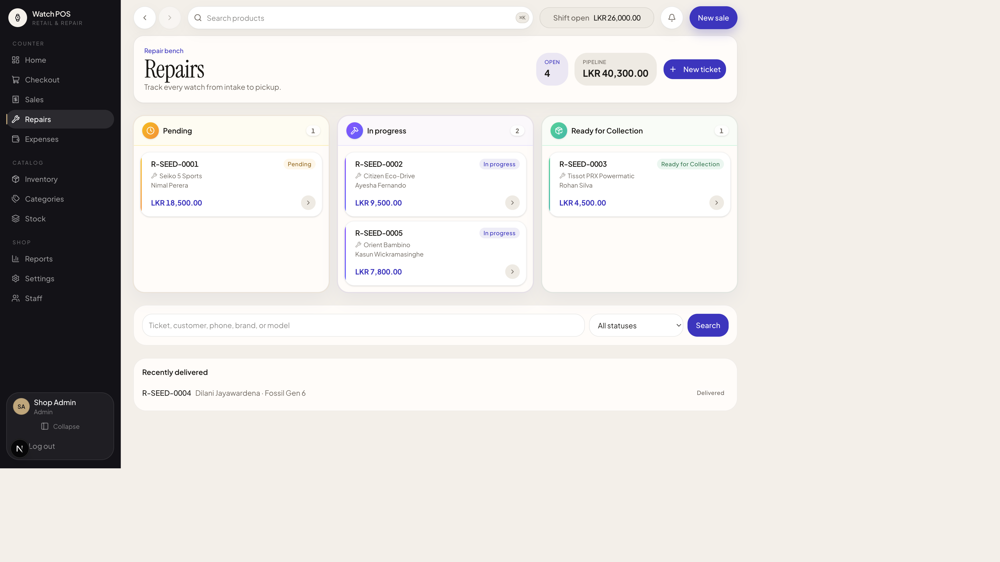

**Repairs** — **Track every watch from intake to pickup.**

| Item | Meaning |
|---|---|
| Open | How many tickets are not yet delivered. |
| Pipeline | The sum of the estimates on those open tickets. This is not money collected. |
| New ticket | Starts a new intake. |

Three columns, with a count on each:

1. **Pending** — received, work has not started
2. **In progress** — on the bench
3. **Ready for Collection** — the customer can pick it up

An empty column says **No tickets here**. A card shows the ticket number, status, brand and model, customer, and estimate. Click it to open the ticket.

Below the columns:

| Control | What it does |
|---|---|
| Ticket, customer, phone, brand, or model | Search text. |
| Status menu | **All statuses**, **Pending**, **In progress**, **Ready for Collection**, **Delivered**. |
| Search | Runs the search. |
| Search results | Replaces the board view with a list. **No tickets match that search.** if nothing fits. |
| Recently delivered | The latest watches already handed back. **No delivered repairs yet.** when the list is empty. |

### Status path

```
Pending → In progress → Ready for Collection → Delivered
```

You move one step at a time. You cannot jump from Pending to Ready. Delivered is the end of the path. The screen has no button to move a ticket backwards.

### New ticket

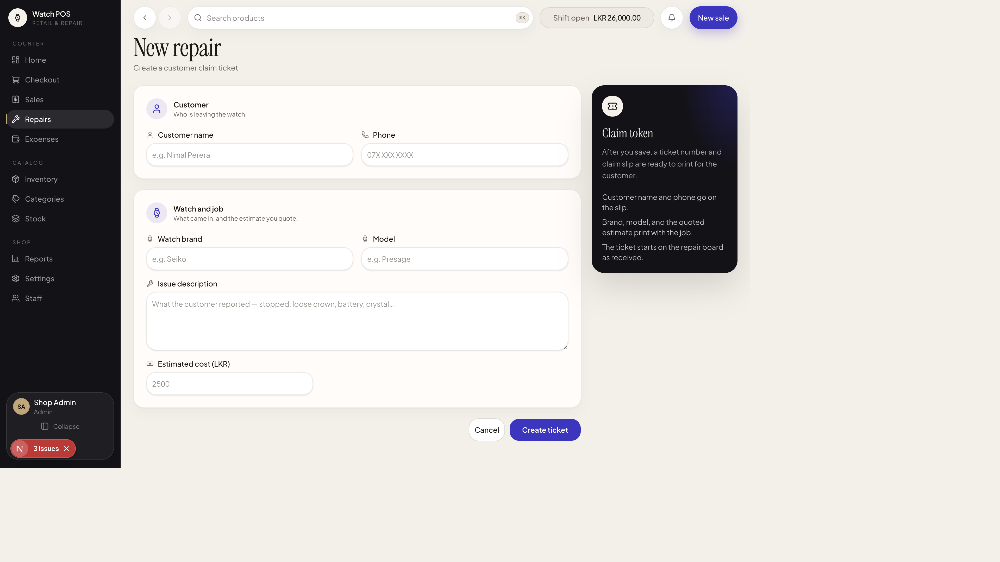

**New repair** — **Create a customer claim ticket.**

**Customer** — *Who is leaving the watch.*

| Field | Rules |
|---|---|
| Customer name | Required. Letters, spaces, apostrophes, dots, and hyphens. At least two characters. Example: `Nimal Perera`. Numbers alone are refused. |
| Phone | Required. A 10-digit Sri Lankan mobile or landline. `0771234567`, `077 123 4567`, and `+94 77 123 4567` are all accepted. The slip stores the `+94` form. |

**Watch and job** — *What came in, and the estimate you quote.*

| Field | Rules |
|---|---|
| Watch brand | Required, up to 40 characters, and it must contain a letter. Example: `Seiko`. |
| Model | Same rules. Example: `Presage`. |
| Issue description | Required, up to 500 characters, and it must contain a letter. Write what the customer said: stopped, loose crown, battery, crystal. |
| Estimated cost (LKR) | Required, greater than zero. Example: `2500`. |

**Cancel** returns to the board without saving. **Create ticket** saves. While it saves, the button reads **Saving…**.

The side panel, **Claim token**, explains what happens next: the slip will carry the customer, the watch, and the quote, and the ticket starts on the board as received (Pending).

If a field is wrong, it is highlighted and a toast says **Check the highlighted fields.** The exact sentences are listed in [Chapter 20](#20-messages-problems-and-questions).

On success you see **Ticket R-… created** and the claim slip opens so you can print it immediately.

### Claim token

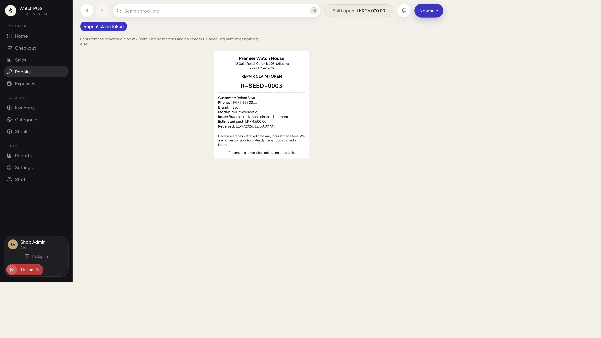

Press **Reprint claim token** any time you need another copy. Print with **no margins** and **no headers**. The paper width follows Settings (58mm or 80mm). Cancelling the print window does nothing else.

The slip shows the shop name, address, and phone, then:

- **Repair claim token** and the ticket number
- Customer, phone, brand, model, issue, estimated cost, and the time it was received
- The repair terms from Settings
- **Present this token when collecting the watch.**

Give this paper to the customer. Keep the watch with the same ticket number written on a job bag.

### Ticket detail

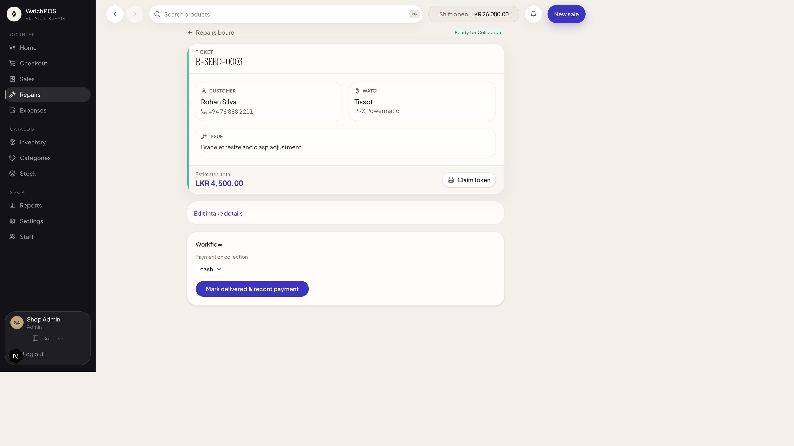

| Area | What it shows |
|---|---|
| Repairs board | Link back to the board. |
| Status pill | Pending, In progress, Ready for Collection, or Delivered. |
| Ticket | The number, such as `R-SEED-0003`. |
| Customer | Name and phone. |
| Watch | Brand and model. |
| Issue | The description from intake. |
| Estimated total | The quote. |
| Claim token | Opens the slip. |
| Edit intake details | Opens the same six fields so you can correct a spelling or a quote. **Save details** writes them. **Close editor** hides the form. |
| Workflow | The next step. |

Cashiers can edit a ticket until it is delivered. An admin can still edit a delivered ticket. Saving writes a note on the ticket history: intake details updated.

**Workflow buttons**

| Current status | Button |
|---|---|
| Pending | **Advance to In progress** |
| In progress | **Advance to Ready for Collection** |
| Ready for Collection | Choose **Cash**, **Card**, or **Bank transfer**, then **Mark delivered & record payment** |
| Delivered | No advance button. The page says **This ticket is closed.** |

The collection payment is always the **estimated total**. There is no box to type a different amount. If the real charge changed, press **Edit intake details**, change **Estimated cost**, save, then mark it delivered.

**Cash** collected here increases the open shift’s expected drawer total. Card and bank transfer do not.

### A repair from intake to pickup

Example: Kamal Fernando leaves a Seiko 5. The quote is LKR 4,500 for a battery and a pressure test. He will pay cash on collection.

1. **Repairs** → **New ticket**.
2. Customer name `Kamal Fernando`, phone `0771234567`.
3. Brand `Seiko`, model `5 Sports`, issue `Battery dead. Customer asked for a pressure test.`, cost `4500`.
4. **Create ticket**. Print the claim slip and hand it to Kamal.
5. When the bench starts, open the ticket and press **Advance to In progress**.
6. When the watch is ready, press **Advance to Ready for Collection**. Call the customer.
7. When he returns with the slip, set payment to **Cash** and press **Mark delivered & record payment**.
8. You see **Ticket updated**. The LKR 4,500 is now repair income for today, and the cash drawer expectation rises by LKR 4,500 if a shift is open.

---

## 11. Inventory

Inventory is the catalog: what you sell at checkout. Everyone can look. Only an admin can add, edit, or remove.

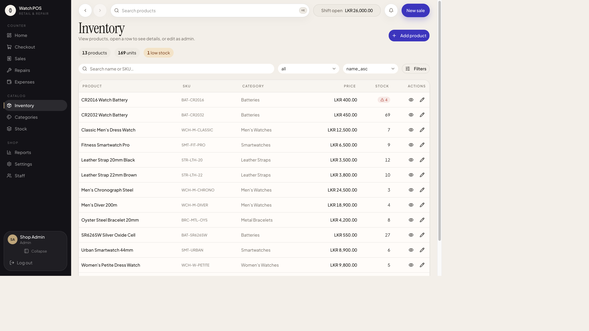

**Inventory** — **View products, open a row to see details, or edit as admin.**

**Add product** (admin) opens the new-product form.

Three summary chips:

| Chip | Meaning |
|---|---|
| N products | How many products match the current filters. |
| N units | The total quantity on hand for those products. |
| N low stock | Click to show only low-stock items. Click again to clear that filter. |

### Filters

Always visible:

| Control | Choices |
|---|---|
| Search name or SKU… | Free text. |
| Category | **All categories**, or one category. |
| Sort | **Name A–Z**, **Name Z–A**, **Price low–high**, **Price high–low**, **Stock low–high**, **Stock high–low**, **Recently updated**. |
| Filters | Opens the extra panel. A number on the button shows how many extra filters are on. |

Inside **Filters**:

| Control | Choices |
|---|---|
| Stock | **All stock**, **In stock**, **Low stock**, **Out of stock**. |
| Brand | **Any brand**, or a brand that exists on a product. |
| Min price (LKR) / Max price (LKR) | Optional range. |
| Inventory tracking | **All**, **Tracked**, **Not tracked**. |
| Include inactive | Admin only. Shows products that were removed from the catalog. |

Active filters appear as chips. Click the × on a chip to remove it, or **Clear all**.

### The table

Columns: **Product**, **SKU**, **Category**, **Price**, **Stock**, **Actions**.

| Action | Who | What it does |
|---|---|---|
| View (eye) | Everyone | Opens the product page. |
| Edit (pencil) | Admin | Opens the product page already in edit mode. |

A low quantity is shown with a warning badge. **No products match your filters.** means you should clear filters. The footer has **Showing …**, a page size of **10 / page**, **20 / page**, or **50 / page**, and **Prev** / **Next**.

### Product page

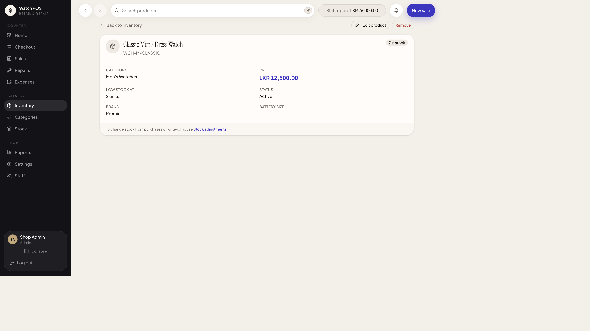

**Back to inventory** returns to the list.

The card shows the name, SKU, **N in stock**, and:

| Label | Meaning |
|---|---|
| Category | The catalog group. |
| Price | Shelf price before discounts. |
| Low stock at | The alert level, in units. |
| Status | **Active** or **Inactive**. |
| Brand | Optional. |
| Battery size | Optional. Useful for cells such as CR2032. Shown as a dash when empty. |

The footer says to use **Stock adjustments** for purchases and write-offs. The quantity on this page is not a box you can type into after the product exists.

**Edit product** (admin) opens the same form as add, with quantity locked. **Save changes** / **Saving…** stores the other fields. **Cancel** leaves edit mode. Success: **Product updated**. Failure: **Save failed**.

**Remove** (admin) asks **Remove this product from the catalog? Past sales stay intact.** Confirming sets the product inactive. It disappears from checkout and from the normal inventory list. Old invoices still show the name and SKU. Success: **Product removed from catalog**. This is not a permanent wipe, and there is no separate “delete forever” button. An admin can find it again with **Include inactive**, edit it, and tick **Active in catalog**.

### Add a product (admin)

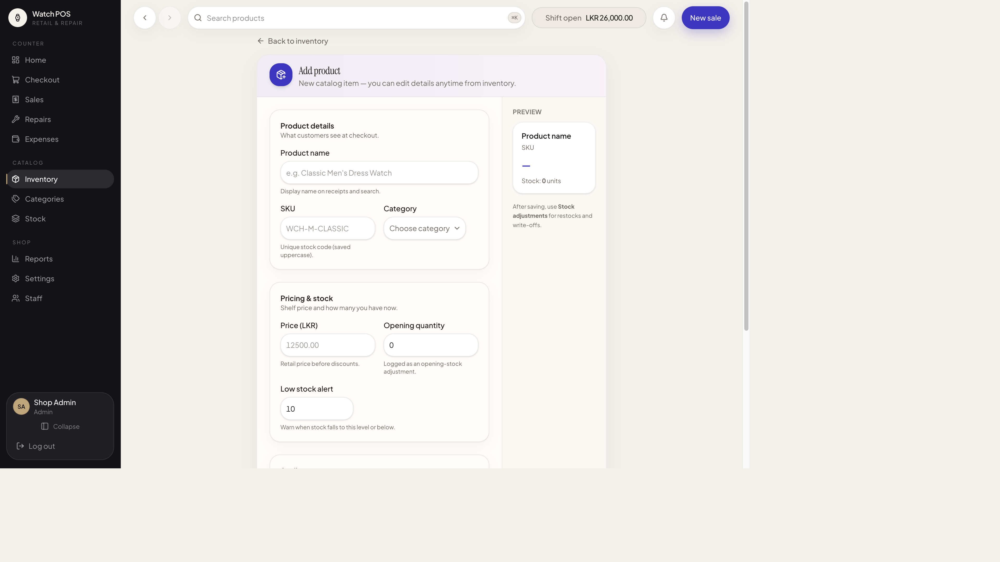

**Add product** — **New catalog item — you can edit details anytime from inventory.**

A cashier who opens this address sees **Only admins can add products** and **Back to inventory**.

**Product details** — *What customers see at checkout.*

| Field | Notes |
|---|---|
| Product name | Required. Example: `Classic Men's Dress Watch`. Shown on receipts and in search. |
| SKU | Required and unique. Example: `WCH-M-CLASSIC`. Saved in capitals. |
| Category | Required. **Choose category**. **Create product** stays disabled until you pick one. |

**Pricing & stock** — *Shelf price and how many you have now.*

| Field | Notes |
|---|---|
| Price (LKR) | Required, greater than zero, up to two decimal places. Letters are not allowed. This is the price before discounts. |
| Opening quantity | How many you have today. `0` is allowed. A number above zero is stored as a stock adjustment with the note “Opening stock”. |
| Low stock alert | Warn when stock falls to this level or below. The form starts at 10. |

**Attributes** — *Brand and battery size help staff find the right item.*

| Field | Notes |
|---|---|
| Brand | Optional. Used by the inventory brand filter. |
| Battery size | Optional. Example: `CR2032`. |
| Active in catalog | Ticked by default. Untick it to save the product hidden from checkout. |

**Cancel** goes back to inventory. **Create product** / **Creating…** saves and opens the new product. The side **Preview** shows the name, SKU, price, and **Stock: N units** as you type.

**Price errors**

- Enter a price greater than 0. Letters are not allowed.
- Price cannot be negative.
- Enter a price greater than 0.

Other failures: **Failed to create product**, or **SKU already exists** if that code is taken.

### Example: add a new strap

1. **Inventory** → **Add product**.
2. Name `Leather Strap 18mm Navy`. SKU `STR-LTH-18`. Category **Leather Straps**.
3. Price `3200`. Opening quantity `6`. Low stock alert `3`. Brand `Premier`.
4. Leave **Active in catalog** ticked.
5. **Create product**.
6. Checkout can sell it immediately, as long as a shift is open.

Later deliveries are not typed on this form. Use **Stock**.

---

## 12. Categories

Admin only. **Categories** — **Deactivate a category instead of deleting it. Products keep their assignment.**

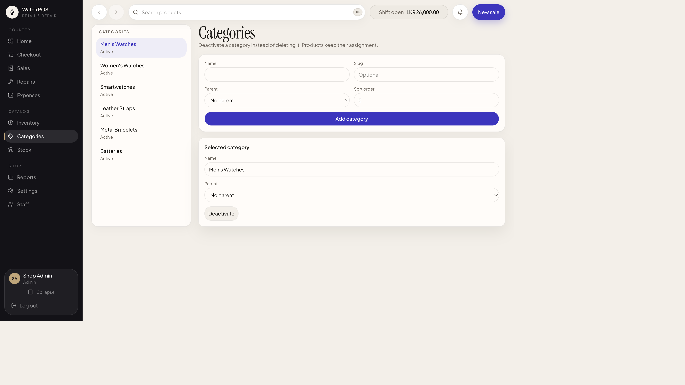

The left list shows every category and whether it is **Active** or **Inactive**. **No categories yet.** appears only on an empty shop.

### Add a category

| Field | Rules |
|---|---|
| Name | Required, up to 40 characters, and it must contain a letter. |
| Slug | Optional. If you type one, use lowercase letters, numbers, and hyphens only, such as `smart-watches`. If you leave it blank, the system builds one from the name. |
| Parent | **No parent**, or another active category. Use a parent only when you want a subcategory. |
| Sort order | A whole number, 0 or higher. Lower numbers are offered first. |
| Add category | Saves. **Category created**, or **Could not create category**. |

A duplicate name is refused: **A category with this name already exists.**

### Change the selected category

Click a name in the list. **Selected category** shows:

| Control | What it does |
|---|---|
| Name | Edit the name. It saves when you leave the field. |
| Parent | Move it under another category, or back to **No parent**. A category cannot be its own parent. |
| Deactivate / Activate | Hides or shows it. Deactivate asks **Deactivate {name}? Products that use it will stay assigned.** |

Deactivating does not move products and does not delete history. An inactive category disappears from the checkout pills and from the normal category menu. Products already in it remain in inventory.

Success toast: **Category updated**.

---

## 13. Stock adjustments

Admin only. This is the only place to add or remove units after a product exists (sales and voids also move stock, automatically).

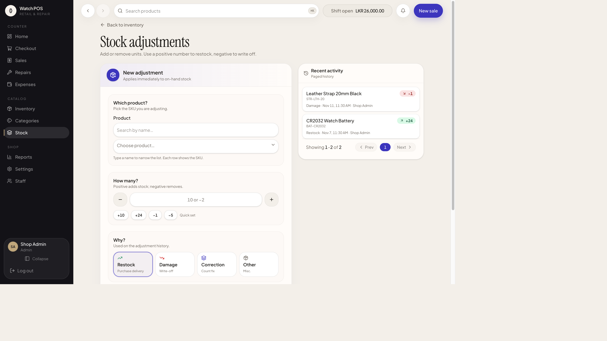

**Stock adjustments** — **Add or remove units. Use a positive number to restock, negative to write off.**

**Back to inventory** returns to the product list.

### New adjustment

*Applies immediately to on-hand stock.*

**Which product?**

| Control | What it does |
|---|---|
| Search by name… | Narrows the product menu. |
| Choose product… | The product. Each row shows the SKU. |
| No product matches that name. | Nothing fit the search. |
| On hand / N after | Once a product and a quantity are chosen, you see the current quantity and what it will become. |
| View product | Opens that product. |

**How many?** — *Positive adds stock; negative removes.*

| Control | What it does |
|---|---|
| − / + | **Decrease by 1** / **Increase by 1**. |
| Quantity box | Type a number such as `10` or `−2`. Zero is refused. |
| +10, +24, −1, −5 | **Quick set**. Replaces the quantity with that value. |

**Why?** — *Used on the adjustment history.*

| Button | Stored reason | When to use it |
|---|---|---|
| Restock — Purchase delivery | Purchase | A supplier delivery. |
| Damage — Write-off | Damage | Broken, lost, or unsellable. |
| Correction — Count fix | Correction | The shelf count and the system disagreed. |
| Other — Misc. | Other | Anything else. |

**Note (optional)** — invoice number, supplier, or damage notes. Example: `Delivery note #4521`.

**Clear form** empties the form. **Apply adjustment** / **Applying…** saves. The button stays disabled until a product, a non-zero quantity, and a reason are set.

| Message | Meaning |
|---|---|
| Enter a non-zero quantity change | Quantity was blank or zero. |
| Quantity cannot go negative | The write-off is larger than the quantity on hand. |
| Stock updated | The quantity changed immediately. |
| Failed | The adjustment did not save. |

### Recent activity

A paged history: product name, SKU, the plus or minus quantity, the reason, when, and who did it. **No adjustments yet.** on a new shop. **Prev** / **Next** move through the pages.

### Example: a delivery of 24 batteries

1. **Stock**.
2. Search `CR2032` and choose **CR2032 Watch Battery**.
3. Press **+24** (or type `24`).
4. Press **Restock**.
5. Note `Delivery note #4521`.
6. **Apply adjustment**.
7. Checkout’s “in stock” badge for that battery rises by 24.

### Example: one damaged strap

1. Choose the strap.
2. Press **−1**.
3. Press **Damage**.
4. Note `Torn keeper, not sellable`.
5. **Apply adjustment**.

---

## 14. Expenses

Expenses are money the shop spent. They are not supplier invoices for stock. Stock you buy for resale belongs in **Stock** as a restock. Expenses are costs such as salaries, bus fare, lunch, electricity, and rent.

Everyone can add and edit. Only an admin sees **Delete** and **Manage types**.

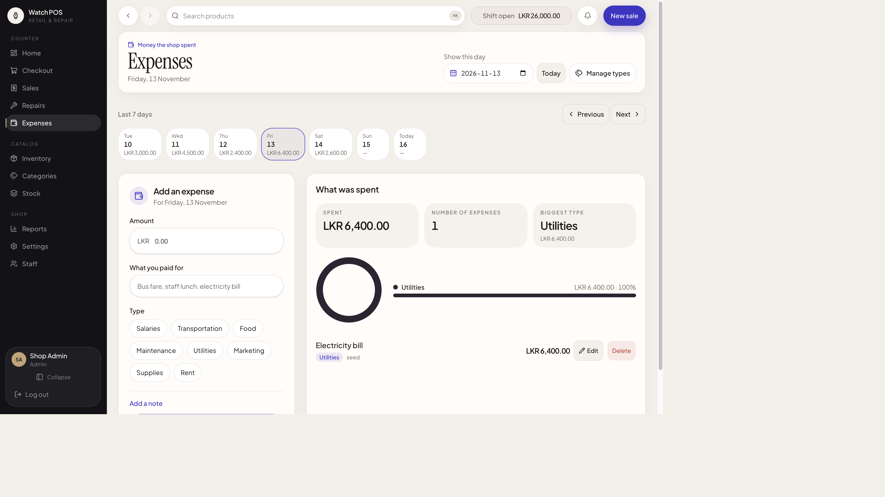

The eyebrow is **Money the shop spent**. The title is **Expenses**, with the selected date under it.

| Control | What it does |
|---|---|
| Show this day | A date picker. |
| Today | Jumps back to today. Disabled when you are already on today. |
| Manage types | Admin. Opens expense types. |
| Last 7 days | **Previous** and **Next** move the week strip. Each day shows the weekday, the date, and the total, or a dash when nothing was spent. Click a day to open it. |

### Add or edit

The form title is **Add an expense** or **Editing this expense**, with **For {that day}**.

If you are editing, a banner says **You are changing a saved expense.** If the expense will move to another date, it says so. **Cancel** abandons the edit.

| Field | Rules |
|---|---|
| Amount | Required, greater than zero. The prefix is **LKR**. |
| What you paid for | Required, up to 120 characters. Example: `Bus fare, staff lunch, electricity bill`. |
| Type | One of the type pills (Salaries, Transportation, Food, and the rest). |
| Add a note | Reveals **Note**, optional, up to 300 characters. |
| Save for {day} | Saves. The button reads **Saving…** while it works. |

**Keyword suggestion.** If the description contains a whole word that belongs to a type, that type is selected for you. Example: typing `electricity bill` selects **Utilities**, and the form says it picked that type because of the word. Tap another type if the guess is wrong.

| Message | Meaning |
|---|---|
| Enter an amount greater than zero. | Amount was empty or zero. |
| Choose what type of expense this is. | No type pill is selected. |
| Describe what the money was spent on. | The description was empty. |
| Keep the description to 120 characters. | Too long. |
| Expense saved | A new row was added. |
| Expense updated | An edit was saved. |
| Could not save the expense | The save failed. |

### What was spent

The right side shows **Spent**, **Number of expenses**, and **Biggest type**, plus a chart of the share of each type.

If more than one type was used that day, **Show one type** filters the list (**All types**, or one type).

Each row has the description, the type, the note, the amount, **Edit**, and (admin) **Delete**.

**Delete** asks **Delete this expense?** **Delete** removes it. **Keep** leaves it. **Expense deleted** confirms. Cashiers do not see Delete.

Empty day: **Nothing was spent on this day** / **Add it with the form.**

### Example

Record Friday’s electricity bill of LKR 6,400.

1. Open **Expenses**.
2. Pick the Friday date, either with **Show this day** or the day chip.
3. Amount `6400`.
4. What you paid for: `Electricity bill`. The type should switch to **Utilities** by itself. If it does not, press **Utilities**.
5. **Add a note** if you want the bill number.
6. **Save for** that Friday.
7. Home and the daily report for that date include the LKR 6,400. Net profit for the day goes down by the same amount.

---

## 15. Expense types

Admin only. These names are the pills on the expense form and the slices on the Home and report charts.

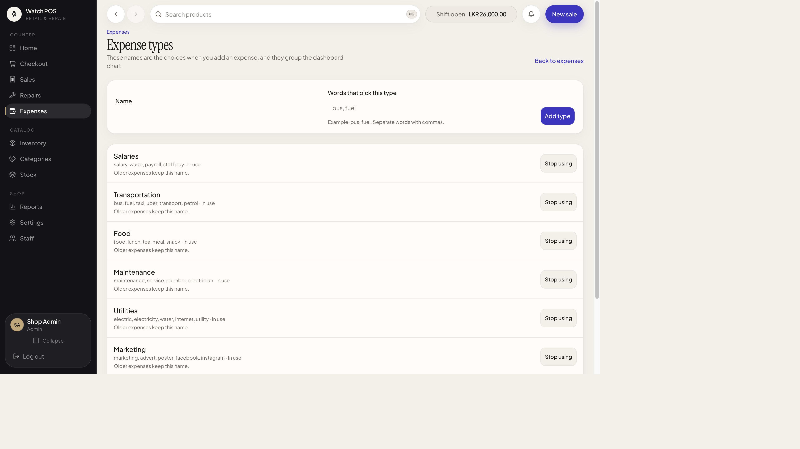

**Expense types** — **These names are the choices when you add an expense, and they group the dashboard chart.**

**Back to expenses** returns to the expense page.

A new shop starts with eight types. Each has words that auto-select it:

| Type | Words that pick this type |
|---|---|
| Salaries | salary, wage, payroll, staff pay |
| Transportation | bus, fuel, taxi, uber, transport, petrol |
| Food | food, lunch, tea, meal, snack |
| Maintenance | maintenance, service, plumber, electrician |
| Utilities | electric, electricity, water, internet, utility |
| Marketing | marketing, advert, poster, facebook, instagram |
| Supplies | supply, supplies, stationery, packaging |
| Rent | rent, lease |

### Add a type

| Field | Rules |
|---|---|
| Name | Same rules as a product category: letters, up to 40 characters. |
| Words that pick this type | Optional. Example: `bus, fuel`. Separate words with commas. A description that contains one of these words as a whole word selects this type. |
| Add type | Saves. **Type added**, or **Could not create this type**. A duplicate name is refused. |

### Stop using a type

Each row shows the name, the words, **In use** or **Not in use**, and **Older expenses keep this name.**

| Button | Effect |
|---|---|
| Stop using | Hides the type from the expense form. Existing expenses keep the name. Toast: **Type is no longer offered**. |
| Use again | Puts it back. Toast: **Type is in use again**. |

You do not delete old expenses by stopping a type.

---

## 16. Daily report

Admin only. This is the end-of-day picture for one Colombo date.

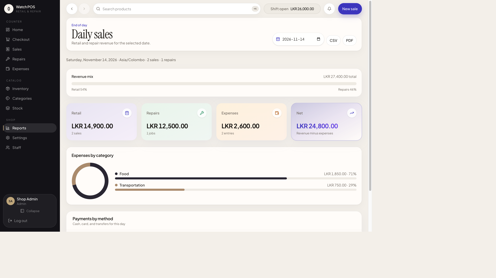

**End of day** / **Daily sales** — **Retail and repair revenue for the selected date.**

| Control | What it does |
|---|---|
| Date | The Colombo day to report. It opens on today. |
| CSV | Downloads a spreadsheet named `daily-report-YYYY-MM-DD.csv`. |
| PDF | Downloads `daily-report-YYYY-MM-DD.pdf`. |

The summary line reads the long date, **Asia/Colombo**, the number of sales, and the number of repairs. It adds **voids** when any invoice was voided that day, and **drawer variance** when at least one shift was closed that day.

### How to read the numbers

The picture above is the sample shop on **Saturday, 14 November 2026**: retail LKR 14,900, repairs LKR 12,500, expenses LKR 2,600, net LKR 24,800.

| Figure | What is included | What is left out |
|---|---|---|
| Revenue mix | Retail plus repairs, and the percent of each. | Expenses. |
| Retail | Sum of **completed** sale totals created that day, and the count of those sales. | Voided sales. |
| Repairs | Payments recorded when a ticket was marked delivered that day. | Open estimates. Pipeline on the repair board is not income. |
| Expenses | Expenses whose date is that day. | Stock purchases. Those are quantity changes, not expenses. |
| Net | Retail + repairs − expenses. | It is not “cash in the drawer”. Card and bank are included in retail and repairs. |
| Expenses by category | The same day’s expenses, split by type. | Other days. |
| Payments by method | Cash, card, and bank transfer from **both** sales and repair collections that day. | A void’s original payment is not left inside this breakdown. |
| Drawer variance | On the summary line, the sum of variances for shifts **closed** that day. | A shift that is still open. Card and bank totals. |

The on-screen cards do not show a separate discount total. The CSV and the PDF do include discounts.

### Export

1. Choose the date.
2. Wait until the cards show that date’s figures.
3. Press **CSV** if you want a spreadsheet, or **PDF** if you want a page to file or send.

Use the report after the drawer is counted if you want the variance line. You can still run the report earlier; variance appears only after a shift is closed on that date.

---

## 17. Staff

Admin only. **Staff** — **Team logins for the shop floor and back office.**

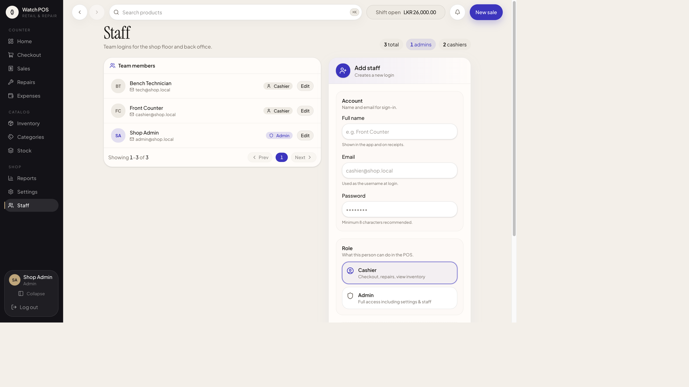

Chips: **N total**, **N admins**, **N cashiers**.

### Team members

Each person shows initials, name, email, a role badge (**admin** or **cashier**), **Inactive** if the login is off, and **Edit**. **No staff yet.** means nobody has been created. The sample shop has Shop Admin, Front Counter, and Bench Technician.

### Add staff

*Creates a new login.*

**Account** — *Name and email for sign-in.*

| Field | Rules |
|---|---|
| Full name | Required, and it must contain a letter. Example: `Front Counter`. Shown in the app and on receipts as the cashier name. |
| Email | Required. This is the username. Example: `cashier@shop.local`. |
| Password | Required, at least 8 characters. |

**Role** — *What this person can do in the POS.*

| Choice | Access |
|---|---|
| Cashier | Checkout, repairs, view inventory. Also expenses, as described in [Chapter 3](#3-who-can-do-what). |
| Admin | Full access, including settings and staff. |

**Preview** shows the name, email, and role as you type. Empty, it reads **New team member** and `email@shop.local`.

**Clear** empties the form. **Create user** / **Creating…** saves.

| Message | Meaning |
|---|---|
| Enter a full name. | The name was blank. |
| Enter a full name using letters. Numbers or symbols alone are not allowed. | The name had no letters. |
| Password must be at least 8 characters | Too short. |
| Email already in use | Someone already has that email. |
| User created | The person can sign in. |
| Failed | The user was not created. |

### Edit staff

**Edit** opens **Edit staff**.

| Field | What it does |
|---|---|
| Name | Correct the display name. |
| Role | **Cashier** or **Admin**. |
| New password | Leave blank to keep the current password. If you type one, it must be at least 8 characters. |
| Active login | Untick to block sign-in without deleting the person. Their old sales still show their name. |
| Cancel | Closes without saving. |
| Save / Saving… | Stores the change. **Staff updated** or **Update failed**. |

Tell the person to sign out and sign in again after a role change or a new password.

You cannot delete a staff row. Turn off **Active login** instead. They then see **This account is inactive. Ask an admin to restore access.**

---

## 18. Shop settings

Admin only. These details are what the customer sees on a receipt and on a repair claim slip.

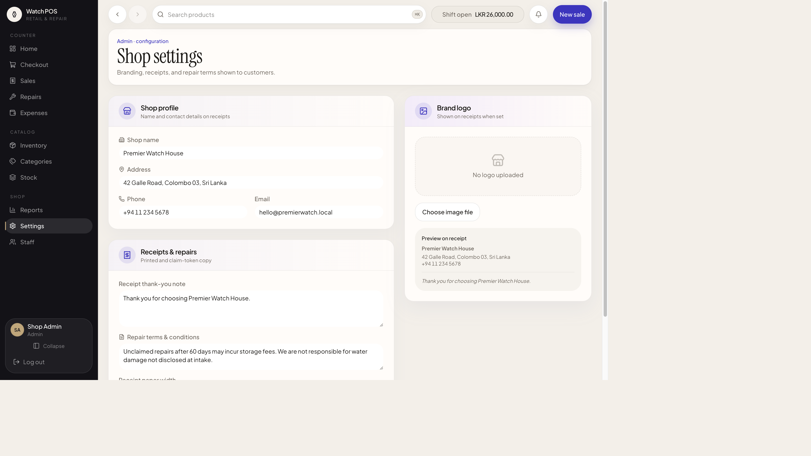

**Admin · configuration** / **Shop settings** — **Branding, receipts, and repair terms shown to customers.**

### Shop profile

*Name and contact details on receipts.*

| Field | Rules |
|---|---|
| Shop name | Required, at least two characters, and it must contain a letter. |
| Address | Required. Printed on the receipt and the claim slip. |
| Phone | Required. Same Sri Lankan number rules as a repair phone. |
| Email | Required. A normal email address. This is the shop contact, not a staff login. |

### Receipts and repairs

*Printed and claim-token copy.*

| Field | What it does |
|---|---|
| Receipt thank-you note | The last lines of a sale receipt. |
| Repair terms & conditions | Printed on the claim slip. Say how long you keep a watch and what you are not responsible for. |
| Receipt paper width | **58mm (compact)** or **80mm (standard)**. This sets both sale receipts and claim slips. |

**Save settings** / **Saving…**. Success: **Settings saved**.

### Brand logo

*Shown on receipts when set.* Until you upload one, the box says **No logo uploaded**.

1. Press **Choose image file**.
2. Pick a JPEG, PNG, or WebP image, up to 5 MB.
3. **Preview on receipt** shows the name, address, phone, and thank-you note as they will look.
4. Success: **Logo updated**. Failure: **Upload failed**, **File required**, **Invalid file type**, or **File too large**.

The logo is stored for the receipt. It does not replace the menu icon.

### Field messages

| Message | What to fix |
|---|---|
| Enter the shop name. | Name is blank. |
| Enter a shop name using letters. | Name has no letters. |
| Enter the shop address. | Address is blank. |
| Enter a phone number. / Use digits only… / Enter a 10-digit Sri Lankan number… / That is not a Sri Lankan mobile or landline prefix. | Phone. |
| Enter an email address. / Enter a valid email address. | Email. |
| Failed to save | The settings were not stored. |

---

## 19. A full shop day

This is the order a counter should follow. The sample uses the admin login; a cashier does the same steps except the report, the void, and the stock change.

### Before the doors open

1. Sign in.
2. Press **No open shift — tap to open**.
3. Count the float. Example: LKR 7,500 in the drawer. Type `7500` and press **Open shift**.
4. Glance at Home. Note **Open jobs** and, if you are an admin, **Low stock**.

### A retail sale

1. **New sale**.
2. Tap the product. Set quantity and any discount.
3. Take cash, card, or a bank transfer.
4. **Complete sale**.
5. **Print receipt** or **Download PDF**.

### A watch comes in for repair

1. **Repairs** → **New ticket**.
2. Fill in the customer, the watch, the fault, and the quote.
3. **Create ticket** and print the claim slip.
4. Move the ticket to **In progress** when work starts, and to **Ready for Collection** when it is ready.

### A watch is collected

1. Open the ready ticket.
2. If the price changed, edit the estimate first.
3. Choose Cash, Card, or Bank transfer.
4. **Mark delivered & record payment**.

### Something the shop paid for

1. **Expenses**.
2. Confirm the date.
3. Amount, description, type, optional note.
4. Save.

### A delivery arrives (admin)

1. **Stock**.
2. Choose the product, a positive quantity, **Restock**, and the delivery-note number.
3. **Apply adjustment**.

### A mistake on an invoice (admin)

1. **Sales** → open the invoice.
2. Type a reason.
3. **Void sale**. Stock returns. Tell the cashier the drawer expectation has dropped if the sale was cash.

### Close

1. Count every note and coin.
2. Press **Shift open** → type the count → **Close shift**.
3. Read the variance toast. If it is not zero, write the reason in the shop day book. The screen does not ask for a variance explanation.
4. **Reports**. Check Retail, Repairs, Expenses, Net, and the payment split.
5. **PDF** or **CSV** if you file the day.
6. **Log out**.

---

## 20. Messages, problems, and questions

### Sign-in

| Message | What to do |
|---|---|
| Invalid email or password | Re-type the email and password. Ask an admin to set a new password. |
| This account is inactive. Ask an admin to restore access. | An admin edits the person and ticks **Active login**. |
| Unable to sign in. Try again. | Retry. If it keeps failing, check that the shop system is running. |

### Drawer and sales

| Message | What to do |
|---|---|
| A shift is already open | Use the shift that is already open, or close it before opening a new one. |
| Invalid opening float | Type zero or a positive amount. |
| Invalid counted cash | Type zero or a positive count. |
| Open a shift before making a sale. | Open the drawer, then press **Complete sale** again. The ticket is still on screen if you have not left the page. |
| Not enough stock for {name}. Available: {n}. | Lower the quantity to the available number, or remove the line. |
| Insufficient cash tendered | Type an amount greater than or equal to the total, or leave the box empty to take the exact total. |
| At least one line item required | Add a product. The button is also disabled on an empty ticket. |
| Payment total must match sale total. | You should not see this from the normal screen. Retry **Complete sale**. |
| Enter a reason to void this invoice | Type why you are voiding. |
| Sale already voided | Nothing more to do. |
| Invoice voided and stock restored | Success. |
| Server error — check MongoDB is running | The database on the shop computer is not reachable. The person who maintains the PC should start it. Your ticket is not saved. |
| Sale failed | Read any extra detail in the message and retry. |

### Repairs

| Message | What to do |
|---|---|
| Enter a customer name using letters. Numbers and symbols are not allowed. | Use a name such as `Nimal Perera`. |
| Enter a phone number. | The phone box is empty. |
| Use digits only. Letters and symbols are not allowed. | Remove letters. Spaces and a leading `+94` are fine. |
| Enter a 10-digit Sri Lankan number, like 0771234567. | Use 10 digits starting with 0, or the `+94` form of that number. |
| That is not a Sri Lankan mobile or landline prefix. | Check the first three digits (070–078 mobiles, or a real area code such as 011). |
| Enter the watch brand. / Enter the model. | Fill the empty box. |
| Keep the brand or model to 40 characters. | Shorten it. |
| Enter a brand or model with letters. Numbers or symbols alone are not allowed. | Include a word, not only digits. |
| Describe the issue. | The issue box is empty. |
| Keep the issue to 500 characters. | Shorten it. |
| Describe the issue using words. Numbers or symbols alone are not allowed. | Add a word. |
| Estimated cost cannot be negative. / Enter an estimated cost greater than 0. | Type a quote above zero. |
| Check the highlighted fields. | Fix the red fields, then save again. |
| This status change isn't allowed. | Move only one step forward. |
| Ticket not found | The link is old. Go back to the board and search. |

### Products, categories, and stock

| Message | What to do |
|---|---|
| Enter a price greater than 0. Letters are not allowed. | Type a number such as `12500` or `12500.00`. |
| Price cannot be negative. | Remove the minus sign. |
| SKU already exists | Choose a different SKU. |
| Missing required product fields | Name, SKU, category, and price are required. |
| Opening quantity cannot be negative | Use zero or more. |
| Enter a category name. / Keep the category name to 40 characters. / Enter a category name with letters. | Fix the name. |
| Use a slug made of lowercase letters, numbers, and hyphens. | Example: `dress-watches`. Or leave the slug empty. |
| Sort order must be a whole number, 0 or higher. | No decimals, no minus. |
| A category with this name already exists. | Use the existing category or pick another name. |
| A category cannot be its own parent. | Choose **No parent** or a different parent. |
| Enter a non-zero quantity change | Type a quantity other than zero. |
| Quantity cannot go negative | You cannot write off more than you have. |
| Only admins can add products. | Sign in as an admin. |

### Expenses, staff, and settings

| Message | What to do |
|---|---|
| Enter an amount greater than zero. / Enter an expense amount greater than zero. | Type the rupees. |
| Choose what type of expense this is. / Choose an expense category. / Choose an active expense category. | Press a type pill. If the type was stopped, an admin turns it back on or you pick another. |
| Describe what the money was spent on. | Fill in **What you paid for**. |
| Keep the description to 120 characters. / Keep the note to 300 characters. | Shorten the text. |
| Choose a valid date. | Pick a real calendar day. |
| Enter a full name. | The staff name is empty. |
| Password must be at least 8 characters | Use a longer password. |
| Email already in use | Use another email, or edit the existing person. |
| You don't have permission for this action. | This login is a cashier, or you need to sign in again after a role change. |
| File too large / Invalid file type | Use a JPEG, PNG, or WebP under 5 MB. |

### Frequently asked questions

**The New sale button does nothing useful and then says to open a shift.**  
The ticket can be built at any time. Completing it requires an open shift. Open the drawer and press **Complete sale** again.

**Two people are on the counter. Do we open two shifts?**  
No. One shift covers the shop. Both people sign in with their own names so receipts show who sold the item. They share the same drawer.

**Why did the drawer not go up when I took a card?**  
Card and bank transfer are recorded on the sale and on the daily report. They are not cash in the drawer.

**The customer paid LKR 5,000 for a LKR 4,500 sale. Why did expected cash rise by 4,500?**  
The extra LKR 500 is the change you give back. Only the sale total stays in the drawer.

**Can I discount a repair?**  
Change the estimated cost on the ticket before you mark it delivered. The collection payment uses that estimate. Checkout discounts apply only to retail products.

**Can I take part payment on a repair?**  
Not on this screen. The payment recorded at collection is the full estimate.

**I voided a sale. Where did it go?**  
It is still under **Sales**. Set status to **Voided**, or open it and read **VOIDED** and the reason. Stock was put back.

**I removed a product by mistake.**  
**Inventory** → **Filters** → **Include inactive** → open the product → **Edit product** → tick **Active in catalog** → **Save changes**.

**Low stock still shows when the quantity equals the alert.**  
That is intentional. “At or below” includes the alert number itself. Sell one more, or raise the alert, or restock.

**A cashier cannot see Reports, and Home → See all on activity sends them to Home.**  
Reports are admin-only. A cashier can still see today’s totals on Home.

**The receipt is cut off or the print has a date in the corner.**  
In the browser print window set margins to **None** and turn headers and footers off. In **Settings**, pick 58mm or 80mm to match the paper roll.

**The daily report does not match the cash I counted.**  
Net includes card and bank, and it subtracts expenses. Expected cash is only the drawer: float + cash sales + cash repairs − voided cash. Compare your count with the shift screen, and compare card and bank with **Payments by method**.

**Subtotal minus Discount does not equal Total.**  
When a line has its own discount, Subtotal is already after that line discount, and Discount still includes it. Use **Total** as the amount to collect. See the worked example in [Chapter 8](#8-checkout).

**I changed someone to admin and they still cannot open Settings.**  
Ask them to log out and log in again.

**Can I delete a staff member or a category?**  
No. Turn the login off, or deactivate the category. History stays intact.

**Does the bell show low stock?**  
No. It says **No new alerts**. Low stock is on Home for admins, and as a badge in Inventory and Checkout.

**What is the Bench Technician login?**  
A cashier. The name describes the job. The role does not add repair-only powers or remove checkout.

---

## Quick reference

| I want to… | Go to… |
|---|---|
| Sign in | The sign-in page. Email and password, then **Sign in**. |
| Open the drawer | Top bar → **No open shift — tap to open**. |
| Sell an item | **Checkout** or **New sale**. |
| Reprint a receipt | **Sales** → invoice → **Print receipt** or **Download PDF**. |
| Cancel a sale | Admin: open the receipt → reason → **Void sale**. |
| Take a watch in | **Repairs** → **New ticket** → print the claim slip. |
| Hand a watch back | Open the ticket → payment method → **Mark delivered & record payment**. |
| See what is on the shelf | **Inventory**. |
| Receive a delivery | Admin: **Stock** → positive quantity → **Restock**. |
| Write off damage | Admin: **Stock** → negative quantity → **Damage**. |
| Record rent or a bill | **Expenses**. |
| See the day | Admin: **Reports**. |
| Add a coworker | Admin: **Staff** → **Create user**. |
| Change the shop name or paper width | Admin: **Settings**. |
| Sign out | **Log out** at the bottom of the menu. |
